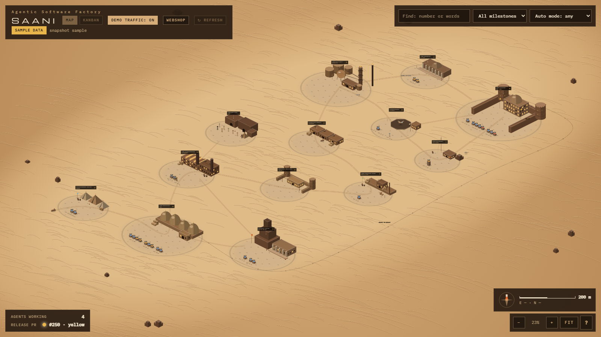

# Saani

**Run Claude Code like a small engineering team on your GitHub repo: parallel agents, no collisions, tests that don't fight, and work that
keeps going while you sleep.**

*Saani* (from Arabic ṣāniʿ, صانع: the maker, the craftsman) is a command-line tool and a Claude Code plugin. It takes a GitHub issue from
idea to production. Each task gets its own git worktree. Work lands on your integration branch one change at a time. All test runs share
one queue on your machine. CI fits inside GitHub's free minutes. A local map shows where every issue stands.



## Why
One Claude Code session is fast. Several at once, or one left alone for hours, run into the same problems:

| Without Saani | With Saani |
|---|---|
| Two sessions edit the same checkout and overwrite each other | `saani start 42` gives each issue its own worktree and branch |
| Agents merge into `dev` at the same time and break it | `saani land` takes a lock, merges, rebuilds generated files, runs the fast tests, pushes, then lets the next one in |
| Parallel test runs slow each other down and time out | `saani test` puts every run in one queue, and each job gets the whole machine |
| You can't tell why a commit was made or how to undo it | A commit-msg hook requires `Why:` and `Undo:` trailers on every commit |
| GitHub Actions minutes run out mid-month | `saani ci` runs a job on GitHub while the free minutes last, and on your PC after that |
| You have to stay at the keyboard | `/saani:auto` lets Claude work through the open issues for hours, then hand back one pull request and a report |
| You don't know where things stand | `saani ui` opens the map: every issue, worktree, test job and Claude session on a local page |

You talk to one Claude Code session, **the Architect**. It plans the work, hands tasks to subagents (**workers**), checks what they return
and reports back to you. Saani provides the commands and rules that keep this safe.

## How it works


The full design (principles, landing rules, test tiers, CI placement, KPIs): [docs/SAANI.md](docs/SAANI.md).

## Requirements
- Python 3.11+ (standard library only: nothing to `pip install`)
- git, and the GitHub CLI [`gh`](https://cli.github.com/), logged in
- [Claude Code](https://code.claude.com/), for the plugin and the auto runs
- A GitHub repo with an integration branch (e.g. `dev`) and a production branch (e.g. `main`), and issues that have a
  [Type](https://docs.github.com/en/issues/tracking-your-work-with-issues/configuring-issues/managing-issue-types-in-an-organization)
  (Task, Feature, Bug), or labels mapped to branch prefixes

Developed and used on Windows (PowerShell 5.1). The code has guards for macOS and Linux, but they are not tested there yet.

## Quick start
You can drive Saani from two places, and use whichever suits the moment:

| Where | What you type | Example |
|---|---|---|
| **A terminal** (PowerShell on Windows, bash or zsh elsewhere), in your project's folder | `saani <command>` | `saani ui --open` |
| **Claude Code**, at its prompt (once the plugin is installed, step 4) | `/saani:<command>`, or just ask in your own words | `/saani:ui`, or "show me the UI" |

Both run the same command. In Claude Code, Claude also reads the output and explains it. It tells you why a landing was refused, for example, and it asks
before deleting anything. Setup (`git clone`, `claude plugin ...`) happens in a terminal.

**1. Get Saani** (in a terminal)
```bash
git clone https://github.com/lordlothar99/saani.git
python -I saani/saani.py --version
```
Add a short alias for your terminal (Claude Code does not need it: the plugin brings its own `saani`, step 4):
```bash
alias saani='python -I ~/saani/saani.py'                                 # bash / zsh
```
```powershell
function saani { python -I "$HOME\saani\saani.py" @args }               # PowerShell: add to $PROFILE
```

**2. Configure your project.** Copy [examples/saani.toml](examples/saani.toml) to your project's root, set `repo`, branches and test
commands, and commit it. [docs/CONFIG.md](docs/CONFIG.md) documents every setting. Unknown keys are refused, so a typo is never silently ignored.

**3. Optional: enforce commit trailers.** Copy [.githooks/commit-msg](.githooks/commit-msg) into your project's `.githooks/` and set the
environment variable `SAANI_HOME` to your clone's folder (git runs the hook outside Claude Code). `saani start` turns the hook on in each worktree.

**4. Install the Claude Code plugin** (in a terminal; or inside Claude Code, the same lines with `/plugin` instead of `claude plugin`)
```bash
claude plugin marketplace add lordlothar99/saani
claude plugin install saani@saani
```
Restart Claude Code, then type `/saani:` at its prompt: the slash commands are listed. The plugin is the whole Saani repo, and its
`bin/saani` is on the PATH of Claude's shell, so Claude runs the same version of `saani` as the skills it reads: nothing else to set up. To **update** the plugin later:
```bash
claude plugin marketplace update saani
claude plugin update saani@saani          # then /reload-plugins in an open Claude Code session, or restart it
```
`claude plugin list` shows the installed version; `claude plugin uninstall saani@saani` removes it.

**5. Work an issue.** In Claude Code: `/saani:start 42`, ask Claude to code it, then `/saani:land`. Or the same in a terminal:
```bash
cd ~/projects/webshop
saani start 42        # worktree ../webshop-wt/42-<slug> on feat/42-<slug>, from origin/dev
cd ../webshop-wt/42-*
# ... Claude (or you) codes and commits, with "refs #42", Why: and Undo:
saani land            # lock → merge dev → rebuild → tier-1 tests → push → clean up
```
Or let Claude take the whole backlog while you're away: in Claude Code, `/saani:auto` (or `/saani:auto 12 15` for selected issues).

## Commands
Each command has two forms. In a **terminal**, run it from your project's folder (with the alias from step 1, or as `python -I path/to/saani.py`).
In **Claude Code**, type the slash command, or ask in your own words.

| Terminal | Claude Code | What it does |
|---|---|---|
| `saani ui [--open]` | `/saani:ui` | opens the map at `http://127.0.0.1:8771` (the kanban page is at `/kanban`) (this machine only, read-only). `saani map` and `saani board` work as aliases |
| `saani projects [list\|add [FOLDER]\|remove OWNER/NAME]` | `/saani:projects` | the projects the map's selector offers (`~/.saani/projects.toml`); one map shows them all |
| `saani status` | `/saani:status` | landing lock, worktrees, conflicts per landing, test queue |
| `saani start <n> [--hotfix]` | `/saani:start 42` | worktree and branch for issue `n` from the integration branch (a hotfix starts from the prod tag) |
| `saani comment <n> <kind> [--text T] [--field K=V]` | `/saani:comment 42 blocked --text ...` | a status comment on an issue and its label (`start`, `land`, `ci pr` and `ci merged` post theirs by themselves) |
| `saani land [--dry-run] [--worktree P]` | `/saani:land` | land the current worktree: lock, merge, rebuild, tier-1 tests, push, clean up |
| `saani merge [PR] [--deploy] [--dry-run]` | `/saani:merge`, `/saani:merge --deploy` | merge the green dev -> main pull request an auto run left (merge commit; refused unless mergeable and its CI is green on the exact head), relabel, remove the finished auto runs; `--deploy` then runs `saani deploy`. Saying "merge" or "merge and deploy" in a session means this |
| `saani deploy [--dry-run]` | `/saani:deploy` | the deployer: CI green on the production head (or a merge of a green commit), no issue whose Deploy row says "⛔ Do not deploy", the `[deploy]` checks and dry run, the deploy and its log, then the prod tag moved and the `in-main` issues commented and closed. Owner-typed only |
| `saani test [--kind tier1\|land\|full] -- <cmd>` | `/saani:test`, `/saani:test full` | run a test command through the machine-wide queue (Claude takes the command from saani.toml) |
| `saani prune [--dry-run]` | `/saani:prune` | delete merged branches and finished auto runs (never `dev`, `main` or checked-out ones). Claude shows the list and asks first |
| `saani ci status\|sync\|pr\|merged\|place` | `/saani:ci pr` | hybrid CI: GitHub Actions within the free minutes, the PC for the rest |
| `saani kpis [--baseline]` | `/saani:kpis --baseline` | issues landed per day, conflicts by file, test waits, tokens and estimated cost, compared with the previous window |
| `saani progress run\|show\|watch` | `/saani:progress` | progress bar and time left for a background test run |
| `saani check-msg <file>` | (none) | the commit-msg hook: git runs it, not you |

Claude never runs `/saani:start`, `/saani:land`, `/saani:merge` or `/saani:prune` on its own, because they change your repo: you type them, or ask for them.
In an auto run (`/saani:auto`), Claude lands each issue itself, because you started the run for that.

## The plugin
| Part | Status |
|---|---|
| `/saani:<command>`: a slash command for every `saani` command (see [Commands](#commands)) | available |
| `/saani:auto`: an unattended run over the open issues, ending in one pull request and a report | available |
| Worker subagents `saani:coder`, `saani:tester`, `saani:reviewer`, `saani:scribe`, `saani:researcher` (`agents/`), each on a model that fits the job; the pipeline from an issue to dev is in [docs/PLUGIN.md](docs/PLUGIN.md) | available, not yet tried in an auto run |
| Claude Code hooks (guardrails for unattended runs) | planned |

Details: [docs/PLUGIN.md](docs/PLUGIN.md).

## Status
Early (v0.1 in progress). The command, its config file and the map work, and Saani is developed with itself: this repo has its own
[saani.toml](saani.toml) and every change goes through `saani start` and `saani land`. The roadmap is in the issues (epic #1).

## Contributing
Issues and pull requests are welcome. Run the tests with `python -m pytest -q`. Standard library only. Commits carry `refs #n`, `Why:` and
`Undo:`. Saani is generic, so code, docs and samples never name a real project (samples use the invented `acme/webshop`).

## License
Copyright (C) 2026 lordlothar99. Saani is open source under the [GNU Affero General Public License v3.0 only](LICENSE) (AGPL-3.0-only).

- You can use Saani for any purpose, at work included, and study, change and share it.
- If you distribute Saani or a modified version, **or run a modified version as a network service**, you must offer its complete source
  code under the same license.
- The license covers the code, not the name: don't call a fork or a product "Saani" or present it as the official one.
- To use Saani under other terms (for example in a closed-source product), contact the author through GitHub.
