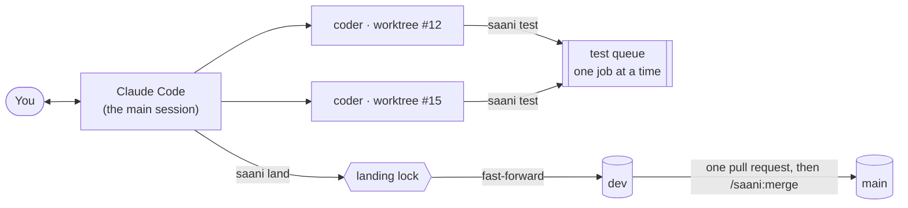

# Saani

**Hand Claude Code your GitHub backlog, go to bed, and find one green pull request and a report in the morning: parallel agents, no
collisions, tests that don't fight, a guard that keeps the run inside its lane.**

*Saani* (from Arabic ṣāniʿ, صانع: the maker, the craftsman) is a command-line tool and a Claude Code plugin: an Agentic Software Factory. It
takes a GitHub issue from idea to production. Each issue gets its own git worktree, work lands on your integration branch one change at
a time, every test run on your machine goes through one queue, CI fits inside GitHub's free minutes, and a local map shows where every
issue stands.


## The auto run
You talk to one **Claude Code** session. In an auto run it works through the open issues by itself, hands each one to worker subagents
and lands it, while Saani's commands and its guard keep the work safe.

1. **Start it.** In Claude Code, `/saani:auto away` (or `/saani:auto away 12 15` for chosen issues). Claude asks its questions first,
   one at a time, while you are still there. Then it starts the run in a headless Claude Code session in the background, so nothing waits
   for an approval while you are gone. `/saani:auto here` runs the same in your own session and asks you whenever it needs to; plain
   `/saani:auto` asks which.
2. **The run.** At most 2 issues in flight per project. For each: its own worktree (`saani start`), a coder subagent, a reviewer
   subagent on the diff (a change of a few lines Claude makes itself), then `saani land`: a lock, a merge, the landing tests, a push
   to `dev`. As soon as one issue lands, the next eligible one starts. Stop rules end it early (40 refusals, 10 of the same reason in
   a row, 10 hours).
3. **The guard.** A plugin hook that decides every tool call of the run at once, never asking: it allows the run's work and refuses
   what a run must never do (push outside `saani land`, merge, read secrets, edit outside its worktrees, run anything off its list).
4. **The end.** One `dev` -> `main` pull request, its CI run (`saani ci`), and a report on it: what landed, what waits for you and
   why, the refusals, the cost. `saani auto status` shows a running run. The run is switched off when it is done: by a small watcher
   when an away session ends, by the skill after the report of a `here` run (add `--keep-on`, as in `/saani:auto away --keep-on`, to
   keep it on; `/saani:auto off` in your own session ends it any time).
5. **Your word.** `/saani:merge` merges the pull request once its CI is green, relabels the issues, removes the run's folder and,
   when the merge changes the version, creates the GitHub release `v<version>` with notes written from the issues.
   `/saani:merge --deploy` (or `/saani:deploy` later) then deploys, if the project deploys.



The full design (principles, landing rules, test tiers, CI placement, the guard, KPIs): [docs/SAANI.md](docs/SAANI.md).

## Requirements
- Python 3.11+ (standard library only: nothing to `pip install`)
- git, and the GitHub CLI [`gh`](https://cli.github.com/), logged in
- [Claude Code](https://code.claude.com/), for the plugin and the auto runs
- A GitHub repo with an integration branch (e.g. `dev`) and a production branch (e.g. `main`), and issues that have a
  [Type](https://docs.github.com/en/issues/tracking-your-work-with-issues/configuring-issues/managing-issue-types-in-an-organization)
  (Task, Feature, Bug), or labels mapped to branch prefixes
- Optional: GitHub's issue statuses. Saani moves them (In progress, In review, Done) and `auto` takes only Todo issues: drag a card to
  Todo on a repository board to let a run take it. Without them, Saani works from its labels

Developed and used on Windows (PowerShell 5.1). The code has guards for macOS and Linux, but they are not tested there yet.

## Install
**1. Get Saani** (in a terminal)
```bash
git clone https://github.com/lordlothar99/saani.git
python -I saani/saani.py --version
```
A short alias for your terminal (Claude Code does not need it: the plugin brings its own `saani`, step 4):
```bash
alias saani='python -I ~/saani/saani.py'                                 # bash / zsh
```
```powershell
function saani { python -I "$HOME\saani\saani.py" @args }               # PowerShell: add to $PROFILE
```

**2. Configure your project.** Copy [examples/saani.toml](examples/saani.toml) to your project's root, set `repo`, the branches and the
test commands (and `[release] version_file` for releases at merge), and commit it. [docs/CONFIG.md](docs/CONFIG.md) documents every
setting. Unknown keys are refused, so a typo is never silently ignored.

**3. Optional: enforce commit trailers.** Copy [.githooks/commit-msg](.githooks/commit-msg) into your project's `.githooks/` and set the
environment variable `SAANI_HOME` to your clone's folder (git runs the hook outside Claude Code). `saani start` turns the hook on in each
worktree.

**4. Install the Claude Code plugin** (in a terminal; or inside Claude Code, the same lines with `/plugin` instead of `claude plugin`)
```bash
claude plugin marketplace add lordlothar99/saani
claude plugin install saani@saani
```
Restart Claude Code, then type `/saani:` at its prompt: the slash commands are listed. The plugin is the whole Saani repo, and its
`bin/saani` is on the PATH of Claude's shell, so Claude runs the same version of `saani` as the skills it reads. To update it later:
`claude plugin marketplace update saani`, then `claude plugin update saani@saani` (and `/reload-plugins` in an open session).

**5. Fewer approvals.** In your project's committed `.claude/settings.json`, allow the `saani` command and put the worktrees folder in
the session's working directories (a relative path is read from the project's folder, so the same line works on every machine):
```json
{"permissions": {"allow": ["Bash(saani *)", "Bash(git -C *)"],
                 "ask": ["Bash(git -C * push*)", "Bash(git -C * reset*)", "Bash(git -C * clean*)"],
                 "additionalDirectories": ["../webshop-wt"]}}
```
`Bash(git -C *)` lets the agents commit in a worktree without asking; it would also let `git -C . push --force` through, so keep the
three `ask` rules beside it. Open Claude Code in the project's main folder (never inside a worktree) and accept its trust dialog once:
the committed settings apply only then, and an away run's headless session needs them too (`saani auto away` warns when the folder is
not trusted yet). `saani status` warns, with the exact line, when the worktrees folder is not covered. Saani's agents never `cd`: they
name the worktree (`git -C`, `saani test --worktree`, `saani land --worktree`).

## At the keyboard
Every step of the auto run is also a command of its own. In a **terminal**, run `saani <command>` from your project's folder; in
**Claude Code**, type the slash command or ask in your own words, and Claude also reads the output and explains it.
```bash
saani start 42        # worktree ../webshop-wt/42-<slug> on feat/42-<slug>, from origin/dev
# ... Claude (or you) codes and commits, with "refs #42", Why: and Undo:
saani land --worktree ../webshop-wt/42-<slug>   # lock → merge dev → rebuild → landing tests → push → clean up
```

| Terminal | Claude Code | What it does |
|---|---|---|
| `saani auto ...` | `/saani:auto [here\|away] [--keep-on] [N ...]` | the auto run above (`auto pick`: the issues it may take now; `auto status`, `auto report`, `auto off --run ID`) |
| `saani ui [--open]` | `/saani:ui` | the map at `http://127.0.0.1:8771` (this machine only, read-only; the kanban page at `/kanban`): issues, worktrees, test jobs, one figure per running subagent, the release pull request, a Status panel (agents working, the release PR's CI light), the signs behind a "?" button; "Stale" when Saani does not answer |
| `saani projects [list\|add [FOLDER]\|remove OWNER/NAME]` | `/saani:projects` | the projects the map's selector offers: one map shows them all |
| `saani status` | `/saani:status` | landing lock, worktrees, conflicts per landing, test queue |
| `saani start <n> [--hotfix]` | `/saani:start 42` | a worktree and branch for issue `n` from the integration branch (a hotfix starts from the prod tag) |
| `saani land [--dry-run] [--worktree P]` | `/saani:land` | land a worktree: lock, merge, rebuild, landing tests, push, clean up |
| `saani test [--kind landing\|full] -- <cmd>` | `/saani:test`, `/saani:test full` | a test command through the machine-wide queue |
| `saani comment <n> <kind>` | `/saani:comment 42 blocked` | a status comment on an issue and its label (`start`, `land` and `ci` post theirs by themselves) |
| `saani merge [PR] [--deploy] [--dry-run]` | `/saani:merge` | merge the green `dev` -> `main` pull request, relabel, clean up, create the release when the version changed |
| `saani deploy [--dry-run]` | `/saani:deploy` | CI green, no issue says "⛔ Do not deploy", checks, dry run, deploy, log, prod tag, issues closed |
| `saani release notes <milestone> \| --pr N` | `/saani:release notes v1.0.0` | the release notes from the issues: by Type, each with its Result line and its commits |
| `saani release create <version>` | `/saani:release create 1.2.0` | the GitHub release by hand (`saani merge` makes it by itself) |
| `saani prune [--dry-run]` | `/saani:prune` | delete merged branches and finished auto runs (Claude shows the list and asks first) |
| `saani ci status\|sync\|pr\|merged\|place` | `/saani:ci pr` | hybrid CI: GitHub Actions within the free minutes, the PC for the rest |
| `saani kpis [--baseline]` | `/saani:kpis` | issues landed per day, conflicts by file, test waits, tokens and estimated cost |
| `saani progress run\|show\|watch` | `/saani:progress` | progress bar and time left for a background test run |

`saani check-msg` (the commit-msg hook) and `saani guard` (the plugin's hook) are run by git and Claude Code, not by you. Claude never
runs `/saani:start`, `/saani:land`, `/saani:merge`, `/saani:deploy`, `/saani:prune` or `/saani:release` on its own: you type them, or
ask for them. In an auto run Claude starts and lands each issue itself, because you started the run for that; it never merges or
deploys. Every option: [docs/SAANI.md](docs/SAANI.md#commands).

## The plugin
A slash command for every `saani` command, the auto skill, the worker subagents `saani:coder`, `saani:reviewer`, `saani:tester`,
`saani:scribe`, `saani:researcher` and `saani:deployer` (each on a model that fits the job), and the guard hook. Details:
[docs/PLUGIN.md](docs/PLUGIN.md).

## Status
On `dev` after v1.0.0 (`saani --version` prints the release). Saani is developed with itself: this repo has its own [saani.toml](saani.toml), every
change goes through `saani start` and `saani land`, and its releases are made by `saani merge`. The roadmap is in the issues.

## Contributing
Issues and pull requests are welcome. Run the tests with `python -m pytest -q`. Standard library only. Commits carry `refs #n`, `Why:` and
`Undo:`. Saani is generic, so code, docs and samples never name a real project (samples use the invented `acme/webshop`).

## License
Copyright (C) 2026 lordlothar99. Saani is open source under the [GNU Affero General Public License v3.0 only](LICENSE) (AGPL-3.0-only).

- You can use Saani for any purpose, at work included, and study, change and share it.
- If you distribute Saani or a modified version, **or run a modified version as a network service**, you must offer its complete source
  code under the same license.
- The license covers the code, not the name: don't call a fork or a product "Saani" or present it as the official one.
- To use Saani under other terms (for example in a closed-source product), contact the author through GitHub.
