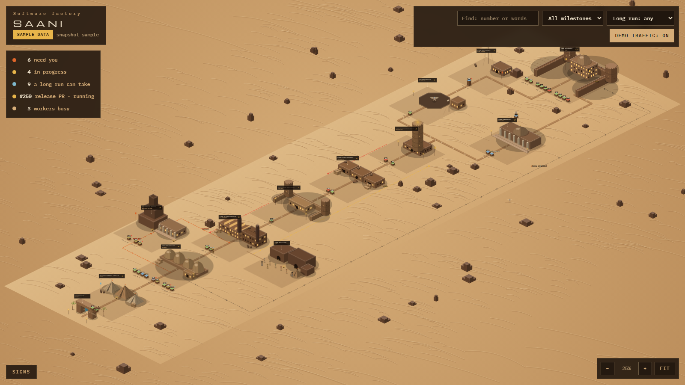
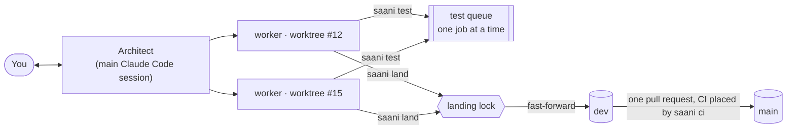

# Saani

**Run Claude Code like a small engineering team on your GitHub repo: parallel agents, no collisions, tests that don't fight, and work that
keeps going while you sleep.**

*Saani* (from Arabic ṣāniʿ, صانع: the maker, the craftsman) is a command-line tool and a Claude Code plugin. It takes a GitHub issue from
idea to production. Each task gets its own git worktree. Work lands on your integration branch one change at a time. All test runs share
one queue on your machine. CI fits inside GitHub's free minutes. A local board shows where every issue stands.



## Why
One Claude Code session is fast. Several at once, or one left alone for hours, run into the same problems:

| Without Saani | With Saani |
|---|---|
| Two sessions edit the same checkout and overwrite each other | `saani new 42` gives each issue its own worktree and branch |
| Agents merge into `dev` at the same time and break it | `saani land` takes a lock, merges, rebuilds generated files, runs the fast tests, pushes, then lets the next one in |
| Parallel test runs slow each other down and time out | `saani test` puts every run in one queue, and each job gets the whole machine |
| You can't tell why a commit was made or how to undo it | A commit-msg hook requires `Why:` and `Undo:` trailers on every commit |
| GitHub Actions minutes run out mid-month | `saani ci` runs a job on GitHub while the free minutes last, and on your PC after that |
| You have to stay at the keyboard | `/saani:longrun` lets Claude work through the open issues for hours, then hand back one pull request and a report |
| You don't know where things stand | `saani board` shows every issue, worktree, test job and Claude session on a local page |

You talk to one Claude Code session, **the Architect**. It plans the work, hands tasks to subagents (**workers**), checks what they return
and reports back to you. Saani provides the commands and rules that keep this safe.

## How it works


The full design (principles, landing rules, test tiers, CI placement, KPIs): [docs/SAANI.md](docs/SAANI.md).

## Requirements
- Python 3.11+ (standard library only: nothing to `pip install`)
- git, and the GitHub CLI [`gh`](https://cli.github.com/), logged in
- [Claude Code](https://code.claude.com/), for the plugin and the long runs
- A GitHub repo with an integration branch (e.g. `dev`) and a production branch (e.g. `main`), and issues that have a
  [Type](https://docs.github.com/en/issues/tracking-your-work-with-issues/configuring-issues/managing-issue-types-in-an-organization)
  (Task, Feature, Bug), or labels mapped to branch prefixes

Developed and used on Windows (PowerShell 5.1). The code has guards for macOS and Linux, but they are not tested there yet.

## Quick start
**1. Get Saani**
```bash
git clone https://github.com/lordlothar99/saani.git
python -I saani/saani.py --version
```
Add a short alias:
```bash
alias saani='python -I ~/saani/saani.py'                                 # bash / zsh
```
```powershell
function saani { python -I "$HOME\saani\saani.py" @args }               # PowerShell: add to $PROFILE
```

**2. Configure your project.** Copy [examples/saani.toml](examples/saani.toml) to your project's root, set `repo`, branches and test
commands, and commit it. [docs/CONFIG.md](docs/CONFIG.md) documents every setting. Unknown keys are refused, so a typo is never silently ignored.

**3. Optional: enforce commit trailers.** Copy [.githooks/commit-msg](.githooks/commit-msg) into your project's `.githooks/` and set
`SAANI_HOME` to your clone. `saani new` turns the hook on in each worktree.

**4. Install the Claude Code plugin**
```bash
claude plugin marketplace add lordlothar99/saani
claude plugin install saani@saani
```

**5. Work an issue**
```bash
cd ~/projects/webshop
saani new 42          # worktree ../webshop-wt/42-<slug> on feat/42-<slug>, from origin/dev
cd ../webshop-wt/42-*
# ... Claude (or you) codes and commits, with "refs #42", Why: and Undo:
saani land            # lock → merge dev → rebuild → tier-1 tests → push → clean up
```
Or let Claude take the whole backlog while you're away: in Claude Code, `/saani:longrun` (or `/saani:longrun 12 15` for selected issues).

## Commands
| Command | What it does |
|---|---|
| `saani new <n> [--hotfix]` | worktree and branch for issue `n` from the integration branch (a hotfix starts from the prod tag) |
| `saani land [--dry-run] [--worktree P]` | land the current worktree: lock, merge, rebuild, tier-1 tests, push, clean up |
| `saani status` | landing lock, worktrees, conflicts per landing, test queue |
| `saani test [--kind tier1\|land\|full] -- <cmd>` | run a test command through the machine-wide queue |
| `saani prune [--dry-run]` | delete merged branches (never `dev`, `main`, long-run branches or checked-out ones) |
| `saani ci status\|sync\|pr\|merged\|place` | hybrid CI: GitHub Actions within the free minutes, the PC for the rest |
| `saani kpis [--baseline]` | issues landed per day, conflicts by file, test waits, compared with the previous window |
| `saani board [--open]` | local status page and board at `http://127.0.0.1:8771` (this machine only, read-only) |
| `saani progress run\|show\|watch` | progress bar and time left for a background test run |
| `saani check-msg <file>` | the commit-msg hook |

## The plugin
| Part | Status |
|---|---|
| `/saani:longrun`: an unattended run over the open issues, ending in one pull request and a report | available |
| Worker subagents (Coder, Tester, Reviewer, Scribe, Researcher), each on a model that fits the job | planned |
| Claude Code hooks (guardrails for unattended runs) | planned |

Details: [plugin/README.md](plugin/README.md).

## Status
Early (v0.1 in progress). The command, its config file and the board work, and Saani is developed with itself: this repo has its own
[saani.toml](saani.toml) and every change goes through `saani new` and `saani land`. The roadmap is in the issues (epic #1).

## Contributing
Issues and pull requests are welcome. Run the tests with `python -m pytest -q`. Standard library only. Commits carry `refs #n`, `Why:` and
`Undo:`. Saani is generic, so code, docs and samples never name a real project (samples use the invented `acme/webshop`).

## License
[PolyForm Noncommercial 1.0.0](LICENSE). You can use, study, modify and share Saani for any **noncommercial** purpose, including personal
projects, research, education, and nonprofit or public organizations. You may not sell it, sell parts of it, or include it in a paid
product or service. For commercial use, contact the author through GitHub.

This is a source-available license. It is not an OSI-approved open-source license.
