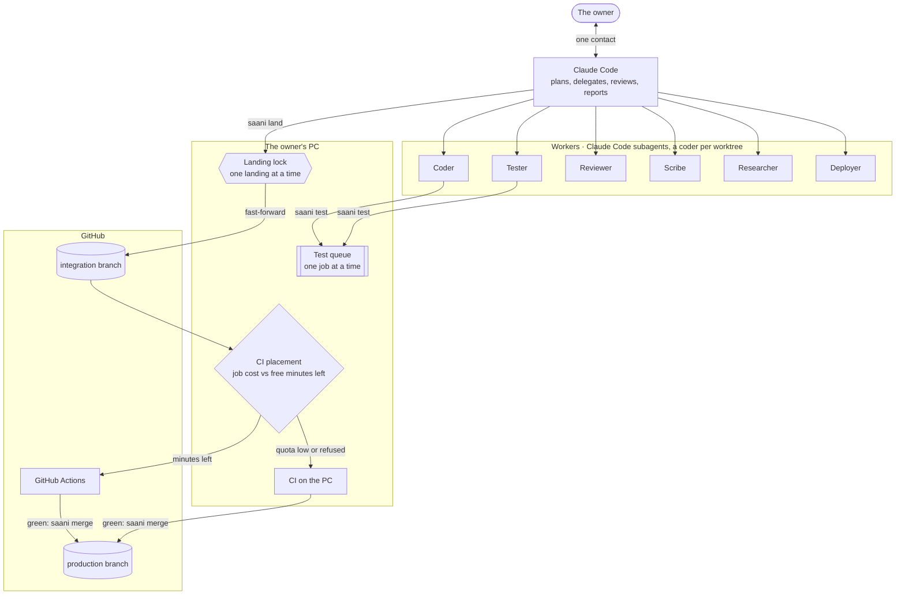

# Saani

Saani is how an AI workshop builds a GitHub project. The owner talks to one contact, **Claude Code** (the main session), which
plans the work, hands parts of it to **workers** (Claude Code subagents, each with a model that fits its job), checks what they bring back
and reports. Saani is the set of commands, rules and pages that keeps that workshop safe and fast: one worktree per task, landings one at a
time, one test queue for the whole PC, CI within GitHub's free minutes, long unattended runs, and a map that shows every issue on its way.
The main way to use it is the auto run ("An auto run", below): Claude Code takes the open issues by itself, under the guard, and ends with
one pull request and a report; the owner's `saani merge` merges it and creates the release. Each step is also a command for the owner at
the keyboard ("Commands").

The status of each feature lives in its GitHub issue (epic: Saani v1), never in this page. The settings of a project live in its
`saani.toml` ([CONFIG.md](CONFIG.md)).

## Principles
- **One contact.** The owner speaks with Claude Code. Claude Code delegates, follows up, decides what comes back to the owner, and asks
  one question at a time, with a recommendation.
- **The right model for each job, from any provider.** A worker is defined by its role and its contract (a task in; a result and its cost
  out), never by a vendor. Each role gets the cheapest model that meets its quality bar, measured. No model at all where a script does the
  job.
- **GitHub CI within the free minutes, the PC for the rest.** GitHub Actions as much as the free plan allows (2,000 minutes a month for
  private repositories, one pool for the whole account), the PC for the rest, decided job by job (`saani ci`). A pull request does not start
  CI by itself: Saani starts it.
- **One worktree per task.** Each task gets its own folder, `<wt>/<issue>-<slug>`, on a branch `<type>/<issue>-<slug>` made from the
  integration branch. Two workers never share a folder. The type comes from the issue's GitHub Type (`[issues] types`); an issue without a
  Type is refused, and a branch's prefix is never renamed if the Type changes later.
- **Landing one at a time.** A finished task takes the landing lock, merges the integration branch, rebuilds the generated files, runs
  the landing tests again and pushes; a conflict goes back to its coder. Then the next one. Claude Code runs `saani land`, never a worker.
- **One test queue.** The tests are the only heavy load on the PC (the models run remotely). One runner takes test jobs in order and gives
  each the whole machine: landings first, then the landing tests, then full runs.
- **The record of a change is its commit message**: `refs #n`, the trailers `Why:` and `Undo:`, then a comment on the issue. A commit on a
  worker's branch or on the integration branch without them is refused (the commit-msg hook, and `land` checks every commit).
- **Narrow keys.** No worker holds a key that can do more than its one job (Deployer: a deploy-only key behind the owner's tap, see
  "Deploy"; planned: Sentinel with read-only diagnostics). A passphrase is never pasted into a chat.

## At a glance


## Commands
`python -I saani.py <command>`, from inside the project's checkout (README, "Install", for a shorter `saani`).

| Command | What it does |
|---|---|
| `saani start <n>` | Reads issue `n`'s Type (refused without one), makes `<wt>/<n>-<slug>` on `<type>/<n>-<slug>` from `origin/<integration>` (or reuses the issue's existing branch), makes `build/` and copies in the newest timing report, switches on the commit-msg hook for that worktree when the project has `.githooks/`, assigns the issue to the owner. `--slug` names it, `--no-assign` skips the assignment, `--no-comment` skips the `Started` comment (branch, worktree folder name). Warns when the issue has no milestone. |
| `saani start <n> --hotfix` | An urgent fix for production: `<type>/<n>-hotfix-<slug>` from the prod tag (what is live), any Type (none: `[issues] hotfix_default_type`); it lists the production commits that are not live, as a warning. `land` on such a branch never touches the integration branch: the landing tests against production, the branch pushed, the pull request into production opened. |
| `saani land` | From inside the worktree: the checks, the lock, the merge, the generated files rebuilt, the landing tests, `git push origin HEAD:<integration>` (never forced), the lock released, the landing recorded, the landing journaled, commented on the issue (the `On dev` kind) and the issue labelled `in-dev` (`--no-comment` only prints that step; when `gh` refuses it prints it too), then the worktree and its local branch removed (all of it runs before the removal, which deletes the worktree's own files; a step that fails prints a `next:` line and the others still run). When `git worktree remove` fails, the message says what is left: still registered (the worktree and branch stay), or unregistered with a folder left behind (the local branch is deleted and Saani deletes the folder itself, read-only files included, retrying for a few seconds; only a folder that stays locked is named for you to remove). `--keep` leaves them, `--dry-run` only checks, `--worktree <path>` lands that worktree from any folder (an auto run cannot change folder). |
| `saani comment <n> <kind> [--text T] [--field K=V ...] [--dry-run]` | Posts a status comment on issue `n` and applies the kind's label change (Status comments, below). |
| `saani status sync [--apply]` | Gives each open issue the GitHub status its state implies (Issue statuses, below): a worktree -> In progress, `in_dev` / `in_main` -> In review, a milestone and no status -> Todo, no status -> Backlog; only forward, and a status you set on an issue nobody works on is left. Without `--apply` it prints what would move. Nothing to do on a repo without statuses. |
| `saani status [--stats]` | What runs, what is blocked, what waits in Saani's machinery: one line per activity (the auto run; a landing holding the lock, or `held (unreadable lock)`; a test run in the queue; a job waiting for the runner: blocked, on what, since when), or one line saying there is no machinery activity; then the open worktrees with no landing or tests in them. Roles (Architect, coder, tester, reviewer) are not visible to Saani, and neither is what a Claude session is thinking or editing, so the lines name what Saani can see (the issue of the worktree, the kind of test run) and not a role. A runner whose process is gone is not reported as running. A test run started outside the queue is looked for in the process list (PowerShell on Windows, `ps` elsewhere, about 4 s at most, best effort) and shown as `tests outside the queue` with its pid, since when, and only the executable's file name and the word that matched, never the command line. Detected: `pytest` or `py.test` as the executable; `python` or `py` with `pytest`, `py.test` or `unittest` among its first three arguments (`python -m pytest`); a `[tests]` `landing` or `full` command of any executable, when the process's words start or end with the command's words. Not detected: a test run by other means (a script of another name, a test run in an editor); those show as idle. When the list cannot be read, the output says `queue idle, but tests may run outside it`. `--stats` prints instead (no process list read): the landing counts, the merged branches and finished auto runs waiting for `prune`, and the test queue's median waits and runs. First, a warning when the worktrees folder is outside every working directory of a Claude Code session of the project (not inside the main checkout, and under no `permissions.additionalDirectories` entry of `.claude/settings.json`, `.claude/settings.local.json` or the user's `settings.json`, in `CLAUDE_CONFIG_DIR` when set), with the line to add: without it every `cd` into a worktree, the agents' included, asks the owner. It only reads those files; a relative entry is taken from the main checkout (Claude Code does not document its base, so the warning gives an absolute path). |
| `saani auto pick [--json] [--limit N] [--only N ...] [--wait MINUTES]` | The issues an auto run may take now, in the run's order (milestone: versions ascending, then other named milestones alphabetically, then none; then the Type whose `[issues] types` prefix is `bug`; then the number; up to 500 open issues are read; `--only` takes just those numbers, before the overlap check), read from one `gh issue list` and each issue's At a glance table: `Auto` yes or partly (no table: eligible, flagged), not blocked, no needs-the-owner row, none of the `answer`, `act`, `idea`, `in_dev` or `in_main` labels, not already in a worktree ("already in a worktree") or on a worker branch ("has a worker branch"), and a Type from `[issues] types`; when the repo has GitHub issue statuses, every ready issue except those in Backlog, the ones named with `--only` too (Issue statuses, below; no status, Todo and the other statuses are eligible; else `in Backlog`; a failure to read the statuses stops the pick). The others are listed with their reason (`no Type`, `blocked by #n` (the still-open blockers), `overlaps #m (path)`...). A `gh` failure stops it with gh's message, never an empty list; options `--json`, `--limit` and `--only` need `pick`, `--id` does not go with it. It also says the free slots (`[auto] parallel` less the issues this run started; the owner's own worktrees take no slot). `--json`: `{slots, parallel, running (this run's issues), owner_running, eligible, skipped, note, warning}`, `note` when there is nothing to start, `warning` when `[auto] parallel` is above 5 (the text output prints it too, and so do `saani auto on` and `saani auto away` at the start of a run). `--wait MINUTES` (#70, Keep-on mode below; the minutes to wait for an issue, not the run's mode): blocks, checking every 3 minutes, until an issue is eligible, the minutes are up (empty `eligible`) or a stop rule of the run is reached (`stop`); prints that JSON plus `waited_minutes` and `keep_on_quiet_minutes`. A script, no model; inside a run it journals why it gave nothing (`pick` and `stop` lines), nothing else. |
| `saani auto [--id ID]` | A throwaway worktree for an auto run: folder `auto-<YYYY-MM-DD_HHMM>` beside the workers' worktrees, branch `auto/<same id>` from the integration branch (never landed; `saani prune` removes it once the run is off, it started more than 2 hours ago and the branch has no commit beyond the integration branch, `saani ci merged` once it is merged; a run that is on, or a branch with commits of its own, is kept and `saani prune` names the reason; below). |
| `saani auto on [--id ID] [--folder PATH] [--deploy] [--here]` | Starts the run's record (`--here`: the interactive sub-mode, the record with `"mode": "here"` and the line `saani auto: here <id> folder=<path>`, which is not the guard's marker, so the session stays in present mode): validates the id and the folder (an existing worktree of this project inside the workers' worktrees folder, not that folder itself, whose main checkout has `saani.toml`; default the current one; the id is `--id`'s, else the folder's name without `auto-`), writes `saani-auto-run.json` in the repository's shared git folder (id, start in UTC, folder, deploy flag, the stop limits) and prints, on success only and as the last line of its output, exactly one line `saani auto: on <id> folder=<absolute run folder>` (nothing like it on failure). The guard registers the Claude Code session after the command exited 0, cued by that line (the process has not the hook's session id), so it must be the whole Bash command. A run that is already on (and not older than the guard's 12 hours) is refused. Inside an auto run the guard refuses `on`, `off` and plain `saani auto` (the worktree maker): make the run's worktree first, in present mode. |
| `saani auto away [--id ID] [--folder PATH] [--only N ...] [--deploy] [--keep-on]` | The away sub-mode's start, from the owner's session: validates the folder as `on` does, then starts a watcher (`saani auto watch`, below) detached, from the main checkout, its output appended to `build/saani-auto-<id>.log`. The watcher runs `claude -p "/saani:auto run <id> --folder <path> [--deploy] [--keep-on] [N ...]" --permission-mode auto --permission-prompts none` with `CLAUDE_CODE_PRINT_BG_WAIT_CEILING_MS=0` so it waits for its background coders, records the session's process id in `build/saani-auto-<id>.pid`, waits for it, and then switches the run off by itself (`saani auto off --run <id>`, in-process; the log gets a line). `--keep-on` only adds the keep-on mode to the session's prompt (below, Keep-on mode). Prints the id, the log, how to follow and how the run ends. A warning (not a refusal) when Claude Code does not trust the main folder yet. Exit 2, with the command to start by hand (which has no watcher: end the run with `/saani:auto off`), when `claude` is not on the PATH or the watcher cannot start. The guard refuses it inside a run (below, An auto run). |
| `saani auto watch --id ID --folder PATH [--only N ...] [--deploy] [--keep-on]` | What `saani auto away` starts; never typed by the owner or a run (the guard's allowlist does not know it, so a run is refused it). It runs the session as above and then ends the run if the record is that of `ID` (a failing session, or one that could not start, ends it too); it always exits 0 and logs `session ended with code N; run switched off` or `session could not start (...)`. |
| `saani auto status [--check]` | The run's id, start, elapsed time, folder, deploy flag, the refusals so far from the guard's log (in all and by reason) and each stop rule with how close it is; for an away run, a warning when its process is gone while the run is still on. `--check` exits 3 when a rule is reached, saying which, else 0 (no run: 0). |
| `saani auto end [--json]` | What the End does about the release pull request: the commits the integration branch is ahead of production, the open pull request, `open`, `update` or `none`, and the no-bump note. Changes nothing. |
| `saani auto report [--pr N] [--post] [--reason TEXT]` | The run's report (below), printed and written to `build/saani-auto-<id>.md` in the main checkout. `--post` comments it on pull request `--pr N` (`gh pr comment --body-file`). |
| `saani auto off [--run ID]` | The owner's end of the run (`/saani:auto off` in the owner's session runs it): the guard refuses it inside the run, so a run never switches itself off. Prints the run's summary, removes the guard's registry entries of the run (every session that registered it: `guard.turn_off_run`) and the record. `--run ID` ends that run even when this repository holds no record of it; it removes only the entries made for this repository's main checkout, never another project's run of the same id. The journal and the report stay in `build/`. An unended run is over after 12 hours anyway. |
| `saani prune [--dry-run] [--local-only]` | Deletes the merged branches: local ones inside production or the integration branch, on GitHub the ones inside production; never those two or a branch checked out in a worktree. An `auto/*` branch (or an old `longrun/*` one) goes with its folder once the run is finished: merged into production or the integration branch, nothing uncommitted in the folder, and started more than 12 hours ago (the run's own limit is 10); a run's folder holds no commits, so its age is what tells it from one still working. A run that finished with nothing landed (no pull request, so never merged) goes too, at once: the run is off (no run record, or the record is for another id) and the branch has no commit beyond the integration branch, with nothing uncommitted in the folder. A run that is on (its record names its id or its folder; a record that cannot be read keeps every run), one that started less than 2 hours ago (between `saani auto` and `saani auto on`), an `auto/*` branch with commits not on the integration branch (or one that cannot be compared with it), or a folder that is dirty or missing is left alone and named with the reason (`kept the auto run <branch>: ...`). GitHub's own "Automatically delete head branches" stays off (it would delete `dev` after every `dev` into `main` pull request); the workflow `.github/workflows/delete-merged-branch.yml` deletes the head branch of a merged pull request into production instead, except `main`, `master` and `dev`. |
| `saani merge [PR] [--deploy [--skip-ci WHY]] [--dry-run]` | The owner's one word at the end of an auto run. Finds the open integration -> production pull request (the number given, else the only one; none or several are refused) and refuses unless it is open, between those two branches, mergeable, and its CI is green on the exact head: the `[ci] status_context` status is `success` and no check run failed or is still running (each refusal says the next step, e.g. `saani ci pr`). Merges with a merge commit (`gh pr merge --merge`: never squash or rebase, the trailers stay; never `--delete-branch`, the head is the integration branch), then does what `saani ci merged` does, then, when `[release] version_file` is set and the pull request changed the version in it, creates the GitHub release (below, Releases). `--deploy` then runs `saani deploy` (below), with `--skip-ci` if given (it never skips the pull request's own CI). `--dry-run` checks and prints, merges nothing. |
| `saani deploy [--dry-run] [--skip-ci WHY]` | The deployer (below): CI green on the production head (a merge of a green commit counts), no issue in production since the prod tag whose Deploy row says not to deploy ("⛔", "Do not deploy"), the `[deploy]` checks and dry run, the deploy with a timeout, its log, the prod tag moved, `✔ Deployed` and the close on each `in-main` issue of the range. `--dry-run` stops after the dry run and prints the command (the key as `<key>`). `--skip-ci` (the owner's) skips only the CI gate (below). |
| `saani test [--kind landing\|full] [--worktree PATH] [--fresh] -- <cmd>` | Runs a test command through the test queue: `landing` (the default) or `full`; the old `tier1` still runs, as `landing`. A clean checkout whose tree and command already passed reuses that result (see The test queue); `--fresh` runs anyway. `--worktree` runs it in that worktree of the project instead of the current folder's checkout, so an agent never needs a `cd` (a subagent's `cd` does not last, and Claude Code asks before `cd <folder> && <command>`). |
| `saani check-msg <file>` | The commit-msg hook. |
| `saani guard` | The plugin's Claude Code hook before every tool call and after every Bash call (below, The guard): JSON on stdin, a decision on stdout during an auto run, nothing otherwise. |
| `saani ci status\|sync\|pr\|merged\|place` | Hybrid CI (below). `ci pr` also posts `In PR` on the issues the pull request names, `ci merged` posts `On main` on those it relabels. |
| `saani kpis [--since D] [--until D] [--baseline] [--json]` | The numbers over a window (below). |
| `saani release create <version> [--target SHA] [--from-pr N \| --milestone TITLE \| --notes-file FILE]` | The GitHub release `v<version>` by hand (also for past versions; exactly one source of notes). Created on `--target` (default: the head of the production branch, resolved to its SHA and printed) with the notes of the pull request's or milestone's issues, or the file (an empty `--notes-file` or `--milestone` is refused). A release that already exists only has its notes edited. A tag that exists without a release is never moved: the release is made on the tag's commit (an annotated tag is peeled), and a `--target` at another commit is refused. A release is "latest" only when it is on the production head (else `--latest=false`). Prints what it did (below, Releases). |
| `saani release notes <milestone> \| --pr N [--short] [--post]` | The release notes, written from the GitHub issues (the CHANGELOG is frozen). Under each issue's line, the subject of each non-merge commit that references it (`refs #n`, as `saani kpis` reads them), oldest first, never a merge commit, trailers never shown, repeats and the subject that repeats the title left out. The range: with `--pr`, the pull request's commits; with a milestone, `git log --no-merges` over `origin/<production>` and `origin/<integration>` (fetch first). Only when git finds nothing (a squash-merged repository), the commits named by the issue's `On dev` comments, merges left out. `--short`: the issue lines only. The milestone's issues that are closed or labelled `[labels] in_main`, or with `--pr N` the issues the pull request names with `refs #n` in its body and commits; as Markdown grouped by the issue Type (REST `type.name`, in the order of `[issues] types`, untyped ones under "Other"), one line each: `#n Title: first sentence under the issue's ## Result` (the issue templates' heading; also `## Results` or `## Result:`, any case; the title alone when there is no Result, or it starts with a table or a code fence; a subheading under it is passed over; `e.g.`, `i.e.`, `etc.` and `vs.` do not end the sentence). With `--pr`, a `refs #n` that is a pull request or cannot be read is skipped with a warning. A `gh` failure stops with gh's message, never an empty list. Nothing is written without `--post`: with `--pr`, the pull request body's `## Release notes` section is set (replaced or appended, `gh pr edit`); with a milestone, the notes of the GitHub release tagged with the milestone's title are replaced (`gh release edit`); no such release is refused (creating one would tag a commit). |
| `saani ui [--open] [--json]` | The local map and kanban page (below): one map for every project in the list below, the one it starts in included. A second `saani ui` finds the running one and opens it. `saani map` and `saani board` are aliases. |
| `saani projects [list\|add [FOLDER]\|remove OWNER/NAME]` | The projects the map's selector offers, in `~/.saani/projects.toml`. |
| `saani progress run\|show\|watch` | A progress bar with the remaining time for a test run in the background. |

## Landing, in detail
- **Before the lock**, `land` refuses: a branch that is not a worker's, uncommitted changes, a commit without the trailers (merges
  excepted, and so is every commit already on `origin/<production>`: history there is never rewritten, so a change made on production
  can come back to the integration branch; the worker's own commits still need them), and a change to a frozen file (`[land] frozen`) once its mark is on the integration branch.
- **The lock** is a file in the repository's shared git folder (`.git/saani-landing.lock`), made atomically, so every worktree sees it. A
  second landing waits (`--wait`, 60 minutes by default); a lock older than `lock_stale_hours` is taken over.
- **Conflicts.** A conflict only in a generated file is solved by the landing (the integration copy, rebuilt next). Any other conflict stops
  the landing and releases the lock: the worker resolves it, commits, and lands again.
- **Generated files** (`[land] generated`, rebuilt by `[land] rebuild`) are rebuilt at landing and committed there, so workers never commit
  them.
- **Landing tests red, or a push refused** (the integration branch moved): the landing merges again and retries, the landing tests
  again only when the new commits touch the branch's files, at most `push_attempts` times; otherwise it stops and nothing reaches the
  integration branch.
- **Landing while a pull request is open**: a finished task lands at once. Each landing makes that pull request's CI stale; the CI runs once
  more right before the merge, and that run is the one that counts.
- **The measure**: each landing appends a line to `build/saani-landings.jsonl` of the main checkout; `saani status --stats` sums it, `saani kpis`
  splits it by file and by window.

## The test queue
Two test runs at once slow each other down and break browser tests with timeouts, so every test job waits for its turn and then has the
whole PC.
- **No daemon.** Each call writes a job file in the shared git folder (`.git/saani-tests/`), waits until it is the first waiting job, takes
  the runner lock (a file made atomically), runs, and releases it.
- **Priority:** kind `land` first (the run inside `saani land`, which holds the landing lock), then `landing` (the landing tests run
  ahead of a landing), then `full`; same priority by arrival. `land` is queued by `saani land` only: `saani test` offers `landing` and
  `full`.
- **Dead jobs** (the process is gone) and a runner lock whose holder is gone are dropped by the next caller.
- **Shared landing tests:** a second `landing` job of the same worktree, commit and command, queued while the first runs, takes the first
  one's result.
- **Reused green results:** a finished job that passed is kept (`.git/saani-tests/result-*.json`) under the git tree id of the tested
  checkout, the expanded command and the kind. A later job of a **clean** checkout (no uncommitted change, no untracked file that is not
  ignored) with the same tree, command and kind does not run: it prints `reused: green on <tree> at <time> (job <id>)` and the log line says
  `reused`. `saani land` reuses when its merged tree equals a tested one; a `full` run (the end of an auto run) also takes a green `landing`
  result of the same tree and command. Never reused: a dirty checkout, a red result (a red run also deletes the green one it contradicts),
  another command or tree, and `saani ci pr` (it always runs). `saani test --fresh` forces a run. The tree is read again when the job gets
  its turn and after the run: a result is stored only when the checkout was the same and clean before and after the run. The key is the
  tracked tree, the command and the kind only: anything outside the tracked tree is not in it (ignored files such as `build/`, git refs such
  as a `--base` branch, commit messages, environment variables, the interpreter and its packages), so use `--fresh` when a run depends on
  those. A result expires after 7 days and the store keeps at most the 100 newest (by finishing time, to the microsecond).
- **The measure:** one line per job in `build/saani-tests.jsonl` of the main checkout (`reused: true` for a reuse).

## Test tiers
| Tier | When | What runs | Setting |
|---|---|---|---|
| fast | while coding an issue | the quick checks and the tests of that issue | the coder's choice (no setting) |
| landing | before each landing | the tests a change can affect | `[tests] landing` |
| full | before a release, and the PC's CI | everything | `[tests] full` (after `[tests] check`) |

A project that cannot tell which tests a change affects sets `landing` to its whole suite; a faster one is the project's own script. The
old key `[tests] tier1` is still read as `landing`, with a message to rename it. Saani's own `landing` and `full` are both `python -m pytest -q`
(no paths), so a test file added or moved under `tests/` is in both tiers.

### Where Saani's own tests go
- One file per module or feature: `tests/test_<module>.py` for `saani/<module>.py` (`test_core.py`, `test_queue.py`, `test_status.py`...).
  A module with many tests is split by area, `tests/test_<module>_<area>.py`: the guard's are `test_guard.py` (Bash commands),
  `test_guard_sensitive.py` (secret files), `test_guard_paths.py`, `test_guard_deadline.py`, `test_guard_registry.py`, `test_guard_plugin.py`.
- Test names say the behaviour (`test_a_<thing>_is_<what>`). Cases that differ only by data are one `@pytest.mark.parametrize` test.
- Shared setup is a fixture in `tests/conftest.py` (`cfg`, `home`, `ctx`, and the git ones: `git`, `repo_copy`, `origin_clone`); helpers that
  are not fixtures go in a `tests/<area>_helpers.py` (`guard_helpers.py`). A helper two files need is moved there, not copied.
- A test never touches the machine's real home, queue, clock or network: use the `home` fixture, `tmp_path`, injected clocks and fakes. Git
  repositories are copied from the fixtures, not built command by command; a subprocess only where the test is about the command itself.

## CI within the free minutes
`saani ci`. The minutes used this month come from GitHub's billing API (every repository of the account: the free minutes are one pool).
- A **heavy** job (`[ci] jobs`, `heavy = true`: the pull request CI) runs on GitHub only if `reserve_minutes` stay after it and the month is
  not spending faster than it passes (`pace_slack`); otherwise on the PC.
- A **small** job runs on GitHub while any minute is left; `saani ci sync` switches the small automatic workflows (those with a `workflow`)
  on or off.
- A job GitHub **refuses** (no step ran: quota out or billing) falls back to the PC by itself.
- A project whose `[ci] workflow` file is not on GitHub's default branch yet has nothing to run there: `saani ci pr` runs the CI on the PC
  and says so in the status. `saani ci pr --pc` forces the PC whatever the budget says.
- On the PC, `saani ci pr` tests the pull request's head in a temporary worktree (`[tests] check`, then `[tests] full` through the test
  queue), removed after. Either way the result is the commit status `[ci] status_context` on the pull request's head.
- After a merge into production, `saani ci merged <PR>` checks that the relabel workflow ran; if not, it runs `[ci] relabel` here, or, with
  no such command, swaps `in-dev` for `in-main` itself with `gh` on the issues the pull request names (`#n` in its title, body and commits;
  a pull request that is not merged is refused). It then removes the auto runs that began before the merge and are finished, so nothing is
  left for the owner.
- Every decision goes to `build/saani-ci.json`.

## The map and the kanban page
`saani ui` (aliases `saani map`, `saani board`) serves `http://127.0.0.1:<port>/` on this PC only (any other Host is refused), refreshed
every 5 s, read-only.
- **`/kanban`, the kanban page:** one card per issue, each with what it needs and a "Copy prompt" to paste to Claude Code. On a repo with
  GitHub issue statuses the columns are the statuses: **Backlog** (status Backlog or none), **Todo**, **In progress**, **In review** and
  **Done** (closed in the last 7 days, folded by default; Not planned and Duplicate in a closed section of it). The GitHub status decides,
  never below where the work is on this PC (a worktree is at least In progress; dev and production at least In review). Inside **In
  review** a section says where the code is: on its branch, on dev, in the release pull request (it keeps its card with the CI in three
  colours), on production to deploy, on production to close (the status stays In review until the issue is closed: `saani deploy` sets Done
  itself later, #84). **Waiting for you** is a row pinned above the columns: every open issue with `help wanted` or `owner-action`, at any
  status; it also stays in its own column. Testing, ready to land and landing are badges on the card, with an agent working; a Backlog or Todo card shows
  why `saani auto pick` would not take it (Auto no or partly, blocked by #n, needs the owner, no Type). Ideas stay off the page, as on the
  map. Without statuses (or `[status] enabled = "off"`) the page keeps its former columns (Waiting for you, Ready, Building, Testing,
  Ready to land, Merged, To deploy, To close, Deployed). `/api/state` carries both: `board` (the map's columns, unchanged) and `kanban` (`columns` with
  `sections`, `pinned`; `null` without statuses); the open pull request with its CI in three colours; the Claude Code sessions of
  the project and what each works on (folder, branch, issue numbers only, never message text); the subagents (defined, planned, built in);
  the PC's load.
- **`/`, the map (the default page; `/map` and the old `/board` open it too):** the same issues as a desert war-game board seen from above.
  Each lifecycle step is a zone along a road from START (bottom left) to END (top right), with branches (to deploy or to close) and the ways
  back (tests failed, CI red, needs you, hotfix, not planned). The first two zones follow GitHub's issue statuses: **Wayfarers' Tents**,
  stage Backlog (filed, not released: status Backlog or none, and Done, Not planned or Duplicate on an open issue: `saani auto pick` takes
  none of them), and **The Granary**, stage Todo (released: status Todo, or In progress / In review with nobody on it; an auto run takes
  it when it is ready). A repo without statuses (or `[status] enabled = "off"`) has the same two zones, filled as `saani status sync`
  would set them: a milestone is Todo, none is Backlog. The server decides it per Ready card (`queue`, saani/board_server.py).
  Between the **Proving Ground** (tests running now) and the **Caravan Depot** (on the integration branch), **The Loading Yard**, stage
  Ready to land, holds the work that only waits for `saani land`: a clean worktree, ahead of the integration branch, whose current tree has
  a green landing-tests result in the test queue (the one `saani land` reuses). A new commit changes the tree and sends it back to the
  Workshops; without `[tests] landing` nothing is known, so it stays in the Workshops.
  Each issue is a block parked at its zone (its colour is its Type, the same
  everywhere; a ring when it needs the owner; a pennant for whether an auto run can take it), the blocks of one milestone side by side, the
  milestone written in the sand in front of them; a search box and the milestone and auto-fit filters narrow what is shown. Each worker is a
  figure: one per running subagent (two coders at once are two figures, each on its own issue; an idle role is one figure in the camp, and a
  worker's panel lists all the runs of its role). The release pull request is the harvester: hover for its CI, click to open its link, the
  issues it carries and a prompt for the whole PR. Hover for a summary, click for the full panel (context, acceptance criteria, history,
  auto fit, the issue's GitHub status, the prompt and the folder to paste it in). Pan and zoom with mouse, keyboard and touch; the signs (what each shape and colour
  means) open from the "?" button in the zoom panel. A Status panel shows how many agents are working and the release pull request's CI
  light (green passed, yellow running, red failed; click it for the PR panel).
- While Saani does not answer, the map keeps the last data on screen, shows "Stale" (since when) and asks less often (every 10, 20, 40,
  then 60 s, back to 5 s once it answers). A hidden browser tab stops asking and pauses the animations. Switching project crosses a
  sandstorm while the other project loads; the refresh button blows a gust of sand over the board.
- Both pages have a top bar with the page switch (Map · Kanban), the project selector (a dot and a count when something waits for the owner
  in that project; the choice is in the address, `#acme-webshop`, so a bookmark opens it) and a refresh, and read the same `/api/state`.
- The map is one HTML file (`saani/map.html`) that also works as a published artifact: it reads `/api/state`, and falls back to
  `mock-state.json` beside it. Its data: [map-data-contract.md](map-data-contract.md).

## Two modes
| | Present | Away (auto run) |
|---|---|---|
| The owner | at the keyboard | asleep or out |
| Questions | allowed, one at a time, with a recommendation | none: a refused call is skipped and noted for the report |
| Tests | fast and landing; full before the pull request | landing per landing, full at the end |
| Deploy | the owner runs it (the Deployer prepares, the owner approves and taps) | never: the owner's "merge and deploy" does |
| Permissions | Claude Code's own: it asks the owner | the guard (below): allow or refuse at once, never ask |

The auto checklist is the plugin's skill (`skills/auto/SKILL.md`). An auto run ends with one green integration -> production pull request
and a report, whenever the integration branch is ahead of production, even if the run landed nothing (issues landed by hand the same day
wait there too): `saani auto end [--json]` decides (ahead: open the pull request, or update the open one; not ahead: none, and the report
says so) and changes nothing itself (it fetches origin first, so the count is current). When the pull request does not change the version in `[release] version_file` (or none is set), its
description and the report say "no version bump: merging creates no release; bump it or merge as is": the run never bumps the version,
the owner decides at merge time whether it is a release. This holds after a stop rule too; the owner then says **merge** or **merge and deploy** (`/saani:merge`, `/saani:merge --deploy`), the only way that pull
request is merged by Saani: the run itself never merges.

## The guard
A Claude Code hook shipped by the plugin (`hooks/hooks.json` runs `saani guard` through `bin/saani` before every tool call, PreToolUse,
and after every Bash call, PostToolUse, each with a 15 s timeout; `saani/guard.py`). A guardrail for unattended runs, not a sandbox:
- the tests an auto run may start run the worktree's own code (a `conftest.py`, a `package.json` script), as every test run does; test
  path arguments must be inside the run's places, so no code from elsewhere is loaded that way;
- an issue, a page or a file can carry instructions. The guard keeps secrets unread and pushes, merges and protected files out of reach,
  but a run may still read non-secret files and send text out through WebFetch, WebSearch or a public comment: a prompt injected into an
  issue could leak what the run can read that way. Keep secrets out of the repository and out of non-secret file names.

**Two modes, by Claude Code session.** The hook's `session_id` is the only key (a subagent's calls carry its parent's `session_id`, so
the workers are covered too); nothing the model can write or the folder it is in turns auto mode on.
- **Present** (no entry for the session in `~/.saani/auto/`): the guard prints nothing, so Claude Code's normal permissions apply, to
  `saani auto on` too: the owner is asked unless their own rules allow it. A present session never switches itself into auto mode. With no
  entry at all it returns before loading anything.
- **Auto** (`~/.saani/auto/<session_id>.json`): every call is allowed or refused, never "ask", because nobody is there to answer. The rules
  below are an allowlist: what is not on it, or what the guard cannot read for sure, is refused, with the reason and how to go on.
- **The switch on: after the command ran.** The PostToolUse hook registers the session when all of these hold: the Bash call's whole
  command is the plugin's `saani auto on [--id ID] [--folder PATH] [--deploy]` (or `python -I <plugin>/saani.py auto on ...`); it ended
  normally (not interrupted, no non-zero exit code if the response reports one); its output holds exactly one marker line
  `saani auto: on <id> folder=<path>`, which the `saani auto on` process prints last, on success only; the marker's id and folder agree
  with `--id` and `--folder` when given; the folder exists inside the worktrees folder of a Saani project. The entry holds the run id, the
  main checkout, the worktrees folder and the settings from the main checkout's `saani.toml` (copied in, so nothing the run edits changes
  the rules; the reference clones among them), the run's folder, `deploy`, the start time. A session already on is never re-armed.
- **The switch off: the owner's.** Inside an auto run `saani auto on` and `saani auto off` are refused: a run never re-arms, resets or
  ends itself. What ends it is outside the run: the watcher of an away run once its session is gone, the skill after the report of a `here`
  run (that session is not guarded), the owner's `/saani:auto off` or `saani auto off --run <id>` from a terminal, and always when the run
  was started by hand (`turn_off_run` removes the run's entries). An entry older than 12 hours is over: renamed
  `<session>.over`, and every call of that session is refused (`run over`), never back to present mode, until `saani auto off --run <id>`
  removes the mark too. A mark that cannot be read (no run id to match it by) keeps its session refused; `saani auto off` removes such
  marks too and names them. `turn_on`, `turn_off`, `turn_off_run`, `state` and `refusals` in `saani/guard.py` are the same switch for
  code.
- **Fail closed.** An entry that cannot be read, a registry that cannot be listed, or hook input that cannot be read while an entry
  exists: refused (`guard error: <what>`). An internal error is a refusal, never a crash. If the hook cannot run at all (timeout, no
  Python), Claude Code's normal permissions apply: it asks.

Each refusal adds a line to `~/.saani/auto/refusals.jsonl`: time, run id, tool, short reason, and the refused command's first word only
(never the command's text, never a file's contents), and the project (the run's main checkout, normalized), so two projects' runs
never mix. `refusals(run, project)` counts them, in total and by reason, for the run's stop rules. The short reason names what the
message to the session names, so `saani auto status` and the report's refusals by reason say what was refused: among others `glob` (an
unquoted `*`, `?` or `[`), `redirect` (a redirection but `2>&1` and `>/dev/null`, `|&`, `&>`, process substitution, a here-document
with an unquoted delimiter `<<EOF` and a here-string `<<<`), `here-document` (a quoted `<<'EOF'` one where it is not allowed),
`environment assignment`, `revision` (off the allowlist), `every ref` (`--all`, `-g`, `--reflog`, `--branches`..., a `:/` search),
`git stash` (the owner's stash), `pathspec` (a folder or a pattern in `add`, `restore`, `checkout`), `network path`, `posix path`,
`drive-relative path`, `secret`, `cd outside the worktrees`, `git in a reference clone`, `not on the list`; `unsure` only for what the guard cannot read (`$`,
backticks, subshells, an unclosed quote, a control character). When several rules apply, the first that refuses gives both the message
and the logged reason (`git -C <main checkout> log --all` is `cd outside the worktrees`). The stop rule "the same refusal reason in a
row" (below) reads these codes: a run of one precise reason reaches it; a mix of them does not, and still counts toward the total.

"The run's places" are the worktrees folder (`[worktrees] folder`), the run's folder and the system temp folder. **Reference clones**
(`[auto] reference_clones`, docs/CONFIG.md) are read only: an upstream project's local clone, beside the project, whose code a run reads
at a tag (`git -C <clone> show <tag>:<path>`, `diff <tag> <tag>`) after fetching its tags, never by a checkout (the owner uses that
clone by hand too). The guard learns them when the run starts, from the main checkout's `saani.toml`, like the worktrees folder; a
clone that is, holds or sits in one of the run's places, the main checkout, temp, `~/.saani` or that holds the home folder is
dropped (then it is outside, as any folder). A path is in a clone after `..`, `/` and `\`, Git Bash's `/c/...` and links or junctions
are resolved: a link out of the clone is judged where it leads. What git itself runs in a clone (its hooks, an fsmonitor, diff or
textconv drivers) comes from the owner's own configuration of that clone, never from the run: the run cannot write there, and `-c`
and the options that run a program are refused. A clone missing on this machine, or one git cannot read here, is not an error:
`saani auto on` warns with the reason and the run goes without it. **Protected**, never
written in an auto run, wherever they are: any path through `.git`, `.githooks` or `.claude`, `.mcp.json`, `CLAUDE.md`,
`CLAUDE.local.md`, `.github/workflows/`, `.github/actions/`, `CODEOWNERS`, `.github/dependabot.yml`, `.gitignore`, `~/.saani/`,
`saani/guard.py`, `saani.toml`, `hooks/hooks.json` and a checkout's top `hooks/` folder (trailing dots and spaces of a name, and a
Windows `:stream` suffix, ignored).

| Tool | Allowed | Refused |
|---|---|---|
| Read, Glob, LS | anywhere | secrets |
| Grep | inside the worktrees folder, the run's folder or a reference clone; a `glob` of plain names (`*.py`) narrows what is looked at (a glob with spaces or commas is several patterns, as Grep reads it: each is judged, and a file any of them matches is looked at) | elsewhere (home, the main checkout, temp); a path that is a `.git` or inside one (a folder or a worktree's `.git` file); a tree holding a `.git` folder that the search could read, whatever ripgrep would skip (no glob, or a glob matching a name in it: `config`, `HEAD`, `*`; the guard walks it like any folder); a file judged a secret by its path below the root or its full path; a `type`; a glob starting with `!`; a folder tree in which the search could read a secret file, judged by each file's path below the root (`.docker/config.json`, `.kube/config`, `.ssh/...`), or a tree too big to look through (past 20000 entries) |
| Edit, Write, MultiEdit, NotebookEdit | inside the run's places | the main checkout, a reference clone, home, anywhere else; secrets; protected files |
| Agent, Task, TodoWrite, ToolSearch, Skill, SendMessage, WebSearch, WebFetch, BashOutput, KillShell, KillBash, TaskOutput, TaskStop, SubagentHandback (a subagent hands its report back) | always | |
| AskUserQuestion | | always: nobody answers; the question goes in the report |
| Any other tool (an MCP tool...) | | always |
| Bash | when every part of the command is allowed (below) | the rest |

**Bash, a strict grammar.** Commands are split on `&&`, `||`, `;`, `|`, `&` and newlines, quotes read as bash reads them. A `cd` moves the
folder the next parts are checked from only across `&&`, into a folder that exists, with nothing but `&&` before it; any other `cd` is
allowed only as the last part. Refused before any rule: `$` outside single quotes (variables, `$(...)`, `$'...'`, `$"..."`,
`$[...]`, `${...}`), backticks, control characters (`\r` included), subshells and braces, `A=b` before a command, `|&`, and every
redirection but `2>&1`, `>/dev/null` and `2>/dev/null` (so no process substitution and no writing through the shell). The only
here-documents: `git commit -F - <<'EOF' ... EOF`, and `"$(cat <<'EOF' ... EOF\n)"` as the exact value of `git commit -m`, or of
`--body`/`--title` of `gh issue comment`, `gh pr create` and `gh pr comment`; the delimiter is quoted, so the body is plain text.
**Every unquoted glob (`*`, `?`, `[`) is refused**, in any word of any command, whatever it would match: bash would expand it after the
guard looked, into words the guard never saw. List files with the Glob tool, read them with Read or Grep, and quote a git pathspec
after `--` (`git diff -- 'src/*.py'`); a quoted glob is plain text.

| Command | Allowed | Refused |
|---|---|---|
| `saani` | the plugin's own (`saani` on the PATH, the plugin's `bin/saani`, `python -I <plugin>/saani.py`), each with its own options only (no abbreviations): `start <n>` (`--slug`, `--no-assign`, `--no-comment`), `land` (`--keep`, `--wait`, `--dry-run`, `--worktree` into a worktree, `--no-comment`), `status` (`--stats`), `comment <n> <kind>` (`--text`, `--field`, `--dry-run`), `kpis` (`--since`, `--until`, `--baseline`, `--ref`, `--json`), `ui` (`--port`, `--open`, `--json`), `progress show <file>`, `progress watch <file>` (`--every`), `auto pick` (`--json`, `--limit`, `--only`, `--wait`), `auto status` (`--check`), `auto report` (`--pr N`, `--post`, `--reason`), `ci status`, `ci pr` (`--dry-run`, `--pc`); `test` (`--kind landing`, `full` or the old `tier1`; `--worktree` into a worktree or the run's folder, as for `git -C`, the test paths then checked from there) only with the project's test commands | another `saani.py`; `auto on`, `auto off`, `auto away`, `auto` itself; `start --hotfix`, `progress run` (it runs any command and writes where `--out` says), `merge`, `prune`, `deploy`, `release`, `projects`, the other `ci` commands (the owner's), `check-msg`, `guard` |
| tests | the project's `[tests] landing`, `full`, `check`, `{python}` being a real Python (`python`, `python3`, `py` from the PATH, or the interpreter running saani), plus `-q`, `-v`, `-x`, `-s`, `--lf`, `--ff`, `-k`, `-m`, `--tb`, `--maxfail`, `--durations` and test paths inside the run's places | any other option, a test path elsewhere (its `conftest.py` would run) (`--basetemp`, `-p`, `--rootdir`, `-c`, `-o`...), `@file` arguments, any other `python` or a path to one |
| `cd` | into a worktree or the run's folder | the worktrees folder itself, a reference clone, anywhere else, `cd -`, options; a `cd` that is not the last part unless `&&` follows it (above) |
| read-only | `ls`, `cat`, `head`, `tail`, `grep` (`-n -i -l -c -E -F -w -v -q -H -h -o`, `--color=never`, `-e PATTERN`, `-A/-B/-C N`), `wc`, `sort`, `find`, `echo`, `test`, `pwd`, `diff` of two files (`-u -q --brief`) | `[` (an unquoted glob: use `test`), `find -delete/-exec/...`, `sort` options off its list (`-o`, `-T`, `--compress-program`...), any other `grep` or `diff` option, recursion in any spelling (`-r`, `-R`, `-d`, `--rec...`; use the Grep tool) |
| `git` | anywhere, reading: `status`, `diff` (paths inside the run's places), `log`, `show` (no `<rev>:<path>` of a secret or outside the repository), `rev-parse`, `ls-files`, `branch` listing, `fetch origin`, alone or with the integration branch, the production branch or worker branches by name (no `pull/`, `refs/`, `FETCH_HEAD`, `:` or `+` refspec: a stranger's pull request is never fetched), `worktree list`. Writing, only in a worktree or the run's folder (the folder it runs in, or `-C` into one; a relative `-C` is read from the `-C` before it, as git reads it), never the main checkout: `add` of named files (`-q`, `-v`); `commit` of what was staged (`-m`, `-F <file>`, `--amend` too); `restore` (`--source`, `--staged`, `--worktree`) and `checkout [<ref>] -- <file>` of named files, the source or ref only `HEAD` (`HEAD~n`, `HEAD^`) or `origin/<integration>`; `switch`/`checkout` of a worker branch (`<type>/<n>-<words>`), a start point only with `-b`/`-c`, and only `origin/<integration>` or `HEAD`; `merge origin/<integration>` (and `--no-edit`, `--abort`, `--continue`); `rebase origin/<integration>` (and `--continue/--abort/--skip`); `stash list` | `push` (only `saani land` pushes, as its own process the hook never sees), `reset --hard`, `clean`, `branch -D`, `worktree remove` (`saani prune` does it), force flags, `--no-verify`/`-n`, `-c`, options that run a program, write a file or move the repository (`--output`, `--upload-pack`, `--exec`, `--git-dir`... and their abbreviations), `diff --no-index`; `commit -a/--all`, `-i/--include`, `-o/--only`, `--pathspec-from-file` and any path argument (it would commit files `add` refuses); in `add`, `restore` and `checkout`: `-A`, `-u`, `.`, `..`, folders, paths ending in `/`, pathspec patterns (`*`, `?`, `[`, `:magic`), protected or secret files; every other `stash` (`refs/stash` is shared by every worktree: `pop`, `apply` and `drop` would take the owner's stash, and a `stash` or `stash push` lands on top of it); the owner's stash read in any command: a stash revision (`stash`, `refs/stash`, `stash@{n}`, `stash^3`, in a range, any case), a `:/<text>` search over every ref, and in `log`, `show`, `rev-parse` and `diff` the options that walk every ref or the reflogs (`--all`, `-g`, `--walk-reflogs`, `--reflog`, `--glob`, `--stdin`, `--branches`, `--remotes`, `--tags` (with or without a pattern: they walk the owner's unpushed branches)... and their abbreviations); any other merge, anything else |
| `git` in a reference clone | only by `git -C <clone>` (relative, absolute, `/` or `\`, `/c/...`; a relative `-C` read from the one before it), reading: `fetch --tags origin` (and `-q`: refs only), `log`, `show` (`<tag>:<path>` too), `diff`, `status`, `rev-parse`, `tag` listing (`-l`/`--list [<pattern>]`, `--sort=`, `--format=`, `-n`), `ls-tree` (`-r -t -d -l -z --long --name-only --name-status --object-only --full-name --full-tree --abbrev`, a tree `<tag>` or `<tag>:<path>`); the same shared rules as elsewhere (options that run a program or write a file, force flags, the owner's stash, every ref, `:/` searches, `diff --no-index`, secrets, `<rev>:<path>` outside the repository); revisions: tags, commit ids, branch names, `HEAD`, `~n`/`^n` and ranges of these; a path word (after `--`, or an existing path) inside the clone | every other git command there (`git in a reference clone`): `checkout`, `switch`, `restore`, `add`, `commit`, `push`, `pull`, `reset`, `clean`, `merge`, `rebase`, `stash` (even `list`), `branch` (even a listing), `worktree`, `config`, `remote`, `tag` that creates or deletes, `ls-files`...; `fetch` of another remote, without `--tags`, with a refspec or a branch, `--prune`, `--prune-tags`, `--all`, `--depth`, a force flag; a reflog `@{n}`; a path outside the clone; `cd` into it; any write tool, `rm` or test path there |
| `gh` | `issue view/list`, `pr view/list/checks/diff`, `run view/list/watch`, `release list` and `release view [tag]` (read-only options only, `--web` refused; on any repository by `--repo OWNER/REPO`, the one place a run may read another project), `api <endpoint>` (GET: no method, field, input or header option at all); `issue comment`, `issue create`, `issue edit` with labels only, `pr comment`, `pr edit`, `pr create` only with `--base <production> --head <integration>` | `pr merge`, every `release` subcommand but `list` and `view` (reason "gh release"), `repo`, `secret`, `auth`; options off the list of that command (read the way gh reads them: `-Bdev`, `-B=dev`, clusters like `-iXDELETE`); `-R`/`--base`/`--head` twice; another repository (except `release list` and `release view`), by `-R` or by a URL or `owner/repo#n` argument (only `https://github.com/<repo>/...` of the project); an endpoint naming a secret |
| `curl`, `wget` | | always: WebFetch reads the web, and a run needs no local server |
| git revisions | (in a reference clone, its own: above) one allowlist, for every allowed git command that takes a revision as a word or as an option's value (`diff`, `log`, `show`, `rev-parse`, `branch --merged/--contains/--points-at`, `commit -C/-c/--fixup/--squash`, `--ancestry-path=`): `HEAD` (`HEAD~`, `HEAD~n`, `HEAD^n`), `origin/<integration>`, `origin/<production>` (reading only), the worker branches and `origin/<worker branch>`, ranges (`a..b`, `a...b`) of those, and `<allowed>:<path>` for `show`; a word of `diff` or `log` that is none of these must be an existing path, and only when the command has no `--` (with one, `diff` and `log` read every word before the first `--` as a revision); `rev-parse` reads its words in order (`-n`, `--default` and `--prefix` take a following `--` as their value), so every word of it, before or after a `--`, and the values of `--default` and `--prefix` must be allowed revisions | any other revision: a commit id, a tag, `FETCH_HEAD`, `ORIG_HEAD`, `@{n}`, another branch; a `:/<text>` search in any word of any git command; `ls-files --with-tree`; `rev-parse --disambiguate` |
| `rm` | named paths inside the worktrees folder or temp | elsewhere, a worktree itself or the worktrees folder, protected files or a folder whose tree holds one (or too big to look through) |
| anything else | | `sudo`, every other command |

**Secrets**, refused to every tool and inside commands: `.env`, `.env.*`, `.envrc`, `*.pem`, `*.key`, `*.p12`, `*.pfx`, `*.ppk`, `*.jks`,
`*.keystore`, `*.kdbx`, `id_rsa*`, `id_ed25519*` (and the other ssh key names), anything with "credentials" in its name (any case),
`.netrc*` and `_netrc`, `.npmrc*` and `npmrc`, `.pypirc`, `.pgpass`, `.git-credentials`, any `hosts.yml`, `.docker/config.json`,
`.git/refs/stash`, `.git/logs/refs/stash` and `.git/packed-refs` (the owner's stash, by its id), `.git/saani-auto-run.json` (the run's
record, which holds the watcher's token), `.git/config` (and any `config` or `config.worktree` deeper in a `.git` folder: a
submodule's `.git/modules/<name>/config`), `.gitconfig` and
`.config/git/config` (tokens in remote URLs and `insteadOf`; git itself still reads them), `.m2/settings.xml`, `.yarnrc.yml`, `pip.ini`,
`pip.conf`, `.bash_history`, `.python_history`, `~/.claude.json*` and `~/.claude/` (but its `projects/*/memory/` and the session's own saved
tool outputs `projects/*/<session>/tool-results/`, never another session's, judged after `..` and links are resolved, so neither is a way to
the rest of `~/.claude/`), PowerShell's history (`PSReadLine/`, `ConsoleHost_history.txt`), anything under `.ssh/`, `.gnupg/`, `.kube/` or
`/proc/`, and a file with "secret" or "token" in its name (in a shell command, a word with "token" that is not a file, like a branch name,
is not one). Paths are compared after `..` is resolved, with `/` and `\`, case-insensitively on Windows.

**Paths, one allowlist (Windows).** Every path, in a tool or a command, is first read the way Git Bash reads it: `\` is `/`, `C:/` is `/c/`,
`..` is folded from the current folder (or `~`) without looking anything up, and it may climb above a drive's root (`/c/..` is `/`). Then
only three absolute forms are read: `/<drive>/...` (that drive, `C:/...`), `/tmp/...` (the temp folder) and exactly `/dev/null`. Everything
else is a place Git Bash maps outside the drives and is refused before any filesystem call: `/`, `/proc`, `/dev/...`, `/etc`, `/usr`,
`/bin`, `/cygdrive`, `/mnt`, `/home`... (`posix path`). A path on a mapped network drive is refused too (Windows tells it from the local
mapping), and so is a drive-relative path (`C:x`, or `C:` alone: that drive's current folder). The other rules then judge the mapped path.

**Network paths** (`\\host\share`, `//host/share`, `\\?\UNC\...`, `\\.\...`) are refused to every tool and in every command before the guard
looks them up: looking one up would connect to that host (and on Windows send the owner's credentials). The `//host/...` of a URL
(`https://...`) is only read as text. **Devices**, `/dev/...` but `/dev/null` (Git Bash's `/dev/clipboard` reads the clipboard), are refused
by the path allowlist above (and elsewhere than Windows by their own rule), and as a redirection (only `>/dev/null`). **The guard's own work
is bounded**: a folder walk (Grep, `rm`) past 20000 entries is refused, and one deadline of 7 seconds covers the whole decision, every walk
of the command together (`too big`; the hook has 15 seconds). The decision also runs under a hard stop: if it has not answered after 9
seconds (a lookup blocked on a slow or disconnected drive), the hook answers deny (`too slow`) and ends at once, so Claude Code's own
permissions never take over by timeout. A tool call whose command or paths are over 32 KB is refused before any work (`too big`; a file's
new content, an edit's text and an agent's prompt are not counted: the guard does not judge them).

Issues and comments have one shape. A new issue starts from the template of its Type (`.github/ISSUE_TEMPLATE/`): an **At a glance** table
(Auto, Deploy, Needs the owner, Blocked by, Parent), then Context, Result, Acceptance criteria, Scope, Decisions for the owner and Links. A
comment starts with one of the kinds in `.github/COMMENT_KINDS.md` (`▶ Started`, `🔎 In review`, `⚙ Progress`, `❓ Question`, `⛔ Blocked`, `✅
On dev`, `📦 In PR`, `🚀 On main`, `✔ Deployed`, `🔗 Linked`). `saani/glance.py` reads the At a glance table (the auto fit, what is deployed,
what the owner is asked, what blocks the issue); the map and the auto run read it through that one parser.

### An auto run
An auto run (`/saani:auto`) keeps up to `[auto] parallel` issues in flight (`0`, the default: sized from the cores and the free RAM, at most 2;
`n` from 1 to 10: fixed, per project, another project's run has its own; more than 10 is refused when saani.toml is read). Above 5 the run
warns, in `saani auto pick` and at its start: each slot is a coder, a reviewer and a test run side by side (tokens, memory, landing conflicts). Each issue goes through the pipeline of docs/PLUGIN.md in its own worktree: `saani start`,
the coder (in the background, so several issues progress at once), the reviewer, fixes, `saani land --worktree`. Landings stay one at a
time (the lock). Claude Code asks `saani auto pick --json` whenever a slot is free and takes the first eligible issue, so an issue that
lands is replaced at once and the list is never a stale one. Two issues whose likely files overlap (the paths the issue body names between
backticks, against the files the running worktrees changed and the other picked issues) are not run side by side: the later one waits, and
`pick` says "overlaps #m (path)". The check is best effort and narrow: only paths named between backticks count (a folder such as `docs/`
does not; a bare `saani.toml` is the root file only), and there is no fallback on title words, so an issue that names no paths never waits
on overlap. The slots are sized from the machine, not from the memory the running issues already use; a conflict at landing goes back to
the coder of that issue. **Whose issues count as running** (#56): only the issues this run started (`saani start` inside a run writes a
`started` line in the run's journal); the owner's own worktrees, made in their own session, take no slot: the run's slots are `[auto]
parallel` less the run's own running issues. The sizing reads the machine's free memory, which already shows the owner's work, so the
machine is not overloaded. `pick` still lists the owner's worktrees (`owner_running`, "the owner's worktrees #12, #15 are in flight"),
keeps their changed files out of other issues, and says "no slot: ..." or "nothing eligible" (`note`, also journaled as a `pick` line when
a run is on, once per change). **A parked issue takes no slot** (#110): an issue the run blocked (its latest `started`, `blocked` or `landed` journal line is `blocked`, written by `saani comment <n> blocked`) keeps its worktree but is not counted against the slots, is not offered again by the same run, and is listed in `pick`'s `parked` (and by `saani status`, "parked: blocked, takes no slot"); a new `started` or the landing clears it. Its changed files still keep overlapping issues waiting. The skill tells the owner about their worktrees before the run starts. Outside a run (no record) every
worktree is the owner's. The record and the journal are per repository, so an owner's own `saani start` while a run is on counts as the
run's and takes one of the run's slots. `saani kpis` gives the cost per issue, role and model.

**Two sub-modes: interactive and away** (#50). `/saani:auto here` runs in the owner's session: the questions any time, `saani auto on
--here` writes the run's record (stop rules, journal, report) without the guard's switch, so the session stays in present mode and the owner
answers the prompts. `/saani:auto away` asks the questions first, then `saani auto away --id <id> --folder <run folder> [--only N ...]
[--deploy] [--keep-on]` starts a headless session itself, detached from the owner's (a minimized console window on Windows, a new session elsewhere), in
the project's main folder so its committed settings apply: `claude -p "/saani:auto run <id> --folder <path>" --permission-mode auto
--permission-prompts none`, its output in `build/saani-auto-<id>.log`. That session runs `saani auto on`, so the guard registers it and
never the owner's. Without `claude` on the PATH, or when the session cannot start, `saani auto away` exits 2 and prints the command to start
by hand. The session is started with `CLAUDE_CODE_PRINT_BG_WAIT_CEILING_MS=0` (the hand command carries it:
`$env:CLAUDE_CODE_PRINT_BG_WAIT_CEILING_MS='0'; claude -p ...` in PowerShell), because `claude -p` otherwise stops its background coders 10
minutes after its last turn and exits (#52). Before it starts, `saani auto away` warns (it does not refuse) when Claude Code's config
(`$CLAUDE_CONFIG_DIR/.claude.json` if set, else `~/.claude.json`) does not show the main folder, or a parent, as trusted
(`hasTrustDialogAccepted`; it reads that flag only, never writes the file): open Claude Code in the folder once and accept the trust dialog.
The session is run by a small detached watcher (`saani auto watch`, #67): it records the session's process id in `build/saani-auto-<id>.pid`,
and `saani auto status` says when that process is gone while the run is still on (then read the log and `saani auto off --run <id>`). When
the session ends, whatever the exit code, the watcher switches the run off by itself, so a finished run does not stay on and refuse the
owner's next commands. A `here` run is ended by the skill itself after the report. A run started by hand has no watcher: the owner ends it with `/saani:auto off`. `saani auto away` refuses while a run
is on (younger than 12 hours). The watcher gives its session a random token in the environment (`SAANI_AUTO_WATCH`); the session's
`saani auto on` copies it into the run's record, and the watcher ends only a record of its run id that carries its own token. So two starts
that overlap before either `on` never end each other's run: the refused one finds a record with the other's token and leaves it on. The
token is written by `saani auto on` only (refused inside a run once it is on), is in the run's record in the git folder, which the guard
protects from reading and from writing (`.git/saani-auto-run.json` is one of its secrets), and is never printed or logged (the log says
"token matched" or "not this session's record"). A record left by a session that never ran `on`, or by another start, stays for the
owner's `/saani:auto off` (the safe direction). With no sub-mode, `/saani:auto` asks "here or away?". Why headless: the guard decides
every call of a run that is on, but an interactive session can still stop on a prompt the guard never sees (Claude Code falls back to
asking after repeated blocks by its auto mode classifier; a background subagent's prompt waits for an answer). With
`--permission-prompts none` every such prompt is a refusal Claude reads and moves past, as the skill does with the guard's;
`--permission-mode auto` lets Claude Code's classifier decide the calls the guard cannot (a hook that timed out). Neither can be set by the project: `defaultMode: "auto"` in a
project's `.claude/settings.json` is ignored by Claude Code, and a plugin's agents cannot set a permission mode.

**Keep-on mode** (#70). `/saani:auto here|away --keep-on` (`saani auto away --keep-on`; `--wait` on `away` is refused) makes the run stay on
and keep taking newly eligible issues (filed, relabelled or answered while it runs) instead of ending when its list is empty, until
`[auto] keep_on_quiet_minutes` without work or a stop rule. In v1.1.0, `--keep-on` meant something else: the watcher did not switch the run
off when the session ended (and the skill did not end a `here` run), so the run's record stayed on until the owner ended it or it lapsed.
That meaning is gone since #70 (the run now ends the normal way after the quiet time; the watcher always switches it off when the session
ends), so the name does not carry two meanings. The skill's loop calls `saani auto pick --wait <minutes>` only when nothing is running and nothing is eligible. That command
blocks, in the standard library and with no model (so no tokens are spent while it waits): it runs the same pick as `pick --json` every 3
minutes, returns as soon as an issue is eligible and a slot is free (eligible issues with no free slot are not news), or after the minutes
with an empty `eligible` (it starts no pick that could end past the minutes), or at once when a stop rule of the run is reached
(`saani auto status --check`'s rules, the missing run record included; the JSON then has `stop`, and a reached limit is journalled as a
`stop` line as `status --check` does; a missing record has no journal to write to). `--wait` must be a finite number above 0. It prints `pick --json` plus `waited_minutes` and
`keep_on_quiet_minutes` (`[auto] keep_on_quiet_minutes`, default 60). The guard allows `--wait` on `saani auto pick` (a refused call would count as a refusal, and the skill treats it as a failed wait: two in a row end the run). A Bash call runs at most 10 minutes, so
the skill waits in calls of 8 minutes and adds the empty ones up (a call that fails or times out counts as an empty wait, followed by
`saani auto status --check`; two failures in a row end the run the normal way): when the quiet time (nothing running, nothing eligible) reaches
`keep_on_quiet_minutes`, or a stop rule is reached, the run ends the normal way (the full run, the one pull request, `saani ci pr` rounds, the
report). Each wait is a Bash call that returns, so the headless session's turn stays open and `claude -p` does not exit (#52). The
watcher is unchanged: it still switches the run off when the session ends. There is one pull request per run; an issue that lands after
it is opened joins it (it runs from the integration branch), and the report says so.

**The run's record and its stop rules.** `saani auto on` is the last step before the work (after the owner's questions); `saani auto off
--run <id>` the end: by itself when an away session ends (the watcher) or after a `here` report, else the owner's, from a terminal. The
stop rules live in one place, `LIMITS` in `saani/auto.py`, and are copied into the run's record at `on`:

| Rule | Limit | Measured by |
|---|---|---|
| refusals in total | 40 | the guard's counter (`guard.refusals(run id)`) |
| the same refusal reason in a row | 10 | the longest run of one reason in the guard's log for this run (3 is too tight with the strict grammar); the reason is the precise short code (`glob`, `redirect`, `here-document`...), so a session alternating between them never reaches this rule: those refusals still count toward the 40 in total |
| hours | 10 | now less the record's start |

The skill runs `saani auto status --check` before each pick and whenever a slot frees (so after each landing); exit 3 (also written to the
journal as a `stop` line) means start no new issue, finish or park the running ones, do the end of the run (full run, the pull request if
the integration branch is ahead of production, `saani ci pr` rounds), write the report, and stop (the watcher ends an away run, the skill a `here` run). Exit 3 also when the record is missing while the guard still holds a run for this repository
("the run record is missing"). Refusals are counted for this repository only: a refusal line that names its project counts for that
project, and a run id the registry holds only for other projects counts nothing here. The guard's own entry also lapses after 12 hours,
so a run that never stops is never in auto mode for ever.

**The journal.** While a run is on, every status comment (`saani comment`, and those `start`, `ci pr` and `ci merged` post) and every
landing adds one JSON line `{time, issue, kind}` to `build/saani-auto-<id>.jsonl`; it never fails the command it notes.

**The report.** `saani auto report` builds the Markdown from the record, git, gh, the guard's log and the journal: start, end, duration, why
the run stopped ("Stopped by": the limit reached, or for a run that started nothing the last pick's reason, "no slot: ..." or "nothing
eligible ...", else "finished the list"; `--reason TEXT` adds one), id and the folder's name only (a report posted on a pull request
holds no path of the owner's machine; the watcher of an away run writes the report itself, from git and the journal, when the session ended without one, and prints its path in the log); the issues landed (the `refs #n` of the integration commits since the start, with their titles); the
issues left with a question or blocked (open issues whose latest status comment, written since the start, is the question or blocked kind,
or whose latest journal line is; an issue that landed is never left); a "Release pull request" section (why there is one, "the integration branch was ahead: N commits" when the run landed nothing, or that the branch was not ahead; the no-bump note; the watcher's fallback report has it too; when it cannot be read, the section says so and why); the refusals by reason; the cost for the window (`saani/cost.py`:
tokens and the estimate per issue, role and model; the window counts whole days from the start's date); the timeline; and the next step:
`/saani:merge N` or `/saani:merge N --deploy`. With `--post` it is also a comment on the pull request. The skill adds what only Claude Code
knows (the options for each pending issue).

### Status comments
`saani comment <n> <kind>` writes a comment in the shape of `.github/COMMENT_KINDS.md` (heading, `--field KEY=VALUE` as a one-row table,
`--text` as the body), posts it with `gh issue comment`, then applies the kind's label change with `gh issue edit` (labels from `[issues]
labels`). Kinds: `started`, `review`, `blocked`, `question` (adds the `answer` label, `help wanted` by default), `progress`, `on-dev` (adds
`in_dev`, `in-dev`), `in-pr`, `on-main` (adds `in_main`, `in-main`, and removes `in_dev`), `deployed`, `linked`. The commands post theirs
themselves: `start` (`Started`, unless `--no-comment`), `land` (`On dev`, unless `--no-comment`), `ci pr` (`In PR`, after the CI status is
set, on the named issues that carry `in_dev`) and `ci merged` (`On main`, on the named issues that carry `in_main` or `in_dev`, whoever did
the relabel), the last two once per pull request and issue. A comment that gh refuses is a warning, never an undone step.

### Issue statuses
GitHub gives every issue a status (public preview since 2026-11-23; no GitHub Project and no extra token scope): Backlog, Todo, In
progress, In review, Done, Not planned, Duplicate. Each has a category (`backlog`, `planned`, `started`, `completed`, `not_planned`,
`duplicate`) that decides whether the issue is open or closed, and a repository board (a saved issue view as a board) lets you drag cards
between them. Saani moves an issue's status forward at its steps, next to the labels, which still say where finished work waits
(`saani/status.py`; the decision is in issue #72 of Saani's own repo):

| Step | Status | Labels |
|---|---|---|
| filed | Backlog (GitHub's default) or no status; an issue in Backlog is not taken by `auto`, so move it out when it may be | |
| `saani start` (the `Started` comment; `--no-comment` sets it anyway) | In progress | |
| the review starts (`saani comment <n> review`), through the fixes | In review | |
| `saani land` (`On dev`; `--no-comment` sets it anyway) | In review | `in-dev` |
| `saani ci merged` / `saani merge` (`On main`) | In review | `in-main` |
| `saani deploy` closes the issue as completed | Done (GitHub sets it on close) | `in-main` removed |
| you close it as not planned or duplicate | Not planned / Duplicate | |
| it needs you | unchanged | `help wanted` / `owner-action` (there is no Blocked status) |

The status never moves back: an issue In review stays there through the landing, the release pull request and main, until the deploy
closes it; a closed issue is never reopened by Saani. `saani auto pick` takes every ready issue except those in Backlog, so Backlog is the
place for what may not be taken yet (an issue with no status, Todo or In progress is taken when it is ready; an open issue still marked Done, Not planned or Duplicate is not). Statuses are matched by the names in `[status] names`, then by category (a renamed status still works). On a repo without
statuses (`planningStatuses` is null), or with `[status] enabled = "off"`, no status is set: each step prints a one-line `status of #n unchanged (...)` instead, and Saani works from its labels alone.
`gh` has no status flag yet: Saani reads and sets statuses with `gh api` (GraphQL `setIssueStatus`, the REST `status` field).

The `--dry-run` of `saani land`, `saani merge` and `saani deploy` (and of `saani comment` and `saani ci merged`) prints the status each
issue would get (`dry-run: #12 status -> In review`; for `deploy`, Done, which GitHub sets when the issue is closed) and sets nothing. A step
that leaves the status alone says why in one line (`status of #12 unchanged (review): already In review`, or: statuses are off in
saani.toml, the repo has none, they could not be read, the issue was not found) and never fails the command.

## Deploy
`saani deploy` (`saani merge --deploy` runs it after the merge; the `saani:deployer` agent runs only its `--dry-run`, reads the logs and
explains a failure: the main session, which sees the owner, runs the real deploy). Settings: `[deploy]` in saani.toml (docs/CONFIG.md).
Each step is printed, the first failure stops with what to do next:
1. CI: the production head (after `git fetch`) has the `[ci] status_context` status `success` and no failed or pending check run. A merge
   commit without a status of its own (what `saani merge` leaves) counts when its tree equals a parent's tree and that parent has them: the
   tested content is what goes live. Anything else is refused: open a new integration -> production pull request and merge it.
   A check run GitHub never started counts as not run, neither passed nor failed: a completed run with GitHub's billing or spending-limit
   annotation ("The job was not started because ..."), or an Actions run that ended `startup_failure` or `cancelled` without a single
   step. It is named and left out, so a merge commit whose only check runs were never started falls back to the parent rule above.
   `saani merge` reads check runs the same way. Any other failure, or a run whose annotations cannot be read, still refuses.
2. The issues: every `refs #n` (also `refs #1, #2 and #3`) in `git log <prod tag>..origin/<production>`, open or closed, is read. One whose
   At a glance Deploy row starts with "⛔", "Do not deploy" or "Don't deploy" (any case) refuses the deploy and is listed. "None", "No" and
   "—" mean there is nothing to deploy and never block (the issue templates offer `None / <what to deploy> / ⛔ Do not deploy: <why>`).
   No prod tag yet: a first deploy, so the open issues labelled `in-main` are read for the marker, and none is commented or closed.
3. The `[deploy] checks` (each exits 0, e.g. disk space), then the `dry_run` command (empty: skipped). `{sha}` in these commands is the
   commit checked.
4. Production is fetched again and must still be that commit (else nothing is deployed). Then the deploy, with `timeout_minutes`: its output
   is shown as it comes (an SSH agent's request to confirm presence reaches the owner) and written to
   `build/saani-deploy-<UTC>.log` of the main checkout. A success is exit 0 and, when `log_ok` is set, a match of that regex in the output
   (an invalid regex is refused before anything runs). A timeout or a failure moves nothing. Use `{sha}` in `command` so the server
   deploys exactly the commit that was checked, not whatever it fetches.
5. After a success: the prod tag moved to the deployed commit and pushed (`git push origin refs/tags/<prod_tag> --force`: the only force
   push Saani does, for the moving tag and nothing else), then `### ✔ Deployed` (commit, log file name; once per commit) on each issue of
   the range labelled `in-main`, and those issues closed as completed.

An auto run never deploys: the owner's "merge and deploy" (or "deploy") does.

**When GitHub will not run the CI** (no paid minutes, a spending limit): `--skip-ci "<why>"` (the owner's, typed by hand; refused in an auto run and without a reason) skips step 1 only, for when GitHub will not run the CI: it prints what the gate said and the reason, writes both at the top of the deploy log, and the other steps all run. `saani merge --deploy --skip-ci "<why>"` does the same after the merge. The guard denies `saani deploy` and `saani merge` in an auto run, and `--skip-ci` is also refused when the headless run's variable `SAANI_AUTO_WATCH` is set. Use it when the content is known to be tested (e.g. the pull request's head was green); it is not a way around a red CI.

**The owner's approval** is that word plus the tap of the SSH agent that holds the deploy key: no phone notification. The key's path is
`[deploy] key`; Saani passes it through (`{key}` in the commands, shown as `<key>` when printed) and never reads its content. Each command
that uses `{key}` may ask for its own tap.

**The owner's side, once** (a sketch, to verify for your setup; Saani does none of it):
- **Never use a bare forced command** (`command="deploy-prod"` and nothing else) with these settings: a forced command ignores what the
  client asked, so every check and the dry run would run the real deploy. Force a gate script instead, which allows only the exact values of
  `$SSH_ORIGINAL_COMMAND` and refuses the rest. In `authorized_keys`:
  `command="/usr/local/bin/saani-gate",no-pty,no-port-forwarding,no-agent-forwarding,no-X11-forwarding ssh-ed25519 AAAA...`
  and the gate:
  ```sh
  #!/bin/sh
  # /usr/local/bin/saani-gate: the only things this key may ask for
  set -fu
  set -- $SSH_ORIGINAL_COMMAND          # split on purpose: every word is checked below
  is_sha() { printf '%s' "$1" | grep -Eq '^[0-9a-f]{40}$'; }
  case "$*" in
    "check-disk") exec /opt/webshop/bin/check-disk ;;
    "deploy-prod --dry-run "*) [ $# -eq 3 ] && is_sha "$3" && exec /opt/webshop/bin/deploy-prod --dry-run "$3" ;;
    "deploy-prod "*)           [ $# -eq 2 ] && is_sha "$2" && exec /opt/webshop/bin/deploy-prod "$2" ;;
  esac
  echo "refused" >&2
  exit 1
  ```
- Better, two keys: the deploy key allows only `deploy-prod <sha>`; a second key, for the checks and the dry run (`checks` and `dry_run`
  name its path directly, not `{key}`), allows only `check-disk` and `deploy-prod --dry-run <sha>`. A mistake in a check then cannot deploy.
- The deploy key held by an agent that asks at each use (for example a hardware key that needs a touch, or an agent with confirm-on-use):
  check that your agent really asks every time, and whether the tap can come from the phone or only from the PC.
- A passphrase is never pasted into a chat.

## Releases
The release notes live in the GitHub issues, not in a file: each issue's `## Result`, its Type and the commits that landed it (`saani
release notes`). `CHANGELOG.md` is frozen. `saani merge` turns them into a GitHub release by itself when it should: after the merge, with
`[release] version_file` set (docs/CONFIG.md), it reads the version in that file on the merge commit and on its first parent (from GitHub,
no checkout needed). A pull request that does not change it creates nothing, and says so. When it does, `v<version>` is created on the merge
commit (`gh release create v<version> --target <merge sha> --title v<version> --notes-file ...`) with the notes of the pull request's issues
(`refs #n`, as `release notes --pr`). When the version it changes to already has a release (a revert, say), the merge does not touch that
release: it prints "no release: v<x> already exists". A tag is never moved or deleted. If the release step fails for any reason, the merge
stays done: `saani merge` prints a `next:` line with the `saani release create <version> --target <sha> --from-pr <N>` to run by hand, and
exits 1; with `--deploy` the deploy still runs and the `next:` line is printed again as the last line. The version is read from the first
line that starts with `version` or `__version__` (the key quoted or not, then `=` or `:` and a quoted value: `__version__ = "1.2.0"`,
`"version": "1.2.0"`), so `python_version`, `target-version` and comments do not count. `saani release create` is that same step by hand,
for a past version too (`--target` a commit, `--milestone` or `--notes-file` for its notes).

## KPIs
`saani kpis` counts what the repository and the logs know: issues landed per day (from the `refs #n` of the integration branch's commits),
landings and conflicts by file, test jobs per kind (median wait and run, failures). The owner's waiting time and interventions have no
machine record: it says "not measured". It also reads Claude Code's session transcripts (`~/.claude/projects/<folder>/`, or under
`CLAUDE_CONFIG_DIR`; the folder of the main checkout and those of the worktrees, subagents included, never a sibling project's) and shows
"Tokens and cost (estimate)": input, output, cache read and cache write tokens and an estimated cost per issue (top 10 by cost), per role
(`architect`: Claude Code's main session, or the subagent's type: coder, reviewer...) and per model, also in `--json` under `tokens`. Only
ids, models, usage numbers, folders, branches, times and subagent descriptions are kept, never a message's text (the lines are parsed whole,
only those fields are retained); a message id counts once. A message belongs to the issue named by its worker branch (the project's own
branch pattern), else by its worktree folder, else by `#n` in its subagent's description, else to "unattributed" (the main session's
overhead). The prices are one table in `saani/cost.py` (USD per million tokens, by model id or family; a cache write costs 1.25x the input
price for 5 minutes, 2x for 1 hour): estimates, to check against the provider's price page; a model without a price shows its tokens and a
cost of "?". `--baseline` adds the window of the same length just before (git history only).

## Models and cost
1. **No model where a script will do.** Running tests, landing, relabelling and the gate are scripts. A model only reads a failure and says
   what it means.
2. **Judgement stays on the strongest model.** Claude Code's main session and the Reviewer keep a top model; a weak review lets bugs
   through.
3. **Routine roles go to the cheapest model that passes.** The Scribe, the Researcher's first pass, the Tester's summary and simple coding
   tasks are candidates for cheaper models, from any provider. Chosen by a trial, never by a price list alone.
4. **Through a harness that keeps the rules.** Whatever the tool, a worker gets the same limits: its own worktree, no push except through
   the landing, no keys. A tool that cannot enforce that runs read-only.
5. **Data.** The code and the prompts go to the provider of each model; a provider that trains on inputs is not used.
6. **Measured.** Each run logs its model and cost; a role moves to a cheaper model only after a trial on real issues shows the same quality.

## Choices, and why
- **Claude Code subagents.** A coding tool with editing, git, tests, review, hooks and permissions per worker.
- **No cockpit app.** Multi-agent cockpits show many agents to a human who dispatches them; here Claude Code dispatches and the owner keeps
  one conversation. The map is enough for a glance.
- **Agent teams later.** Claude Code's agent teams are experimental and document no worktree per teammate; they are to be tried on research
  and review only.

Sources: [Claude Code subagents](https://code.claude.com/docs/en/sub-agents), [Claude Code agent
teams](https://code.claude.com/docs/en/agent-teams).
