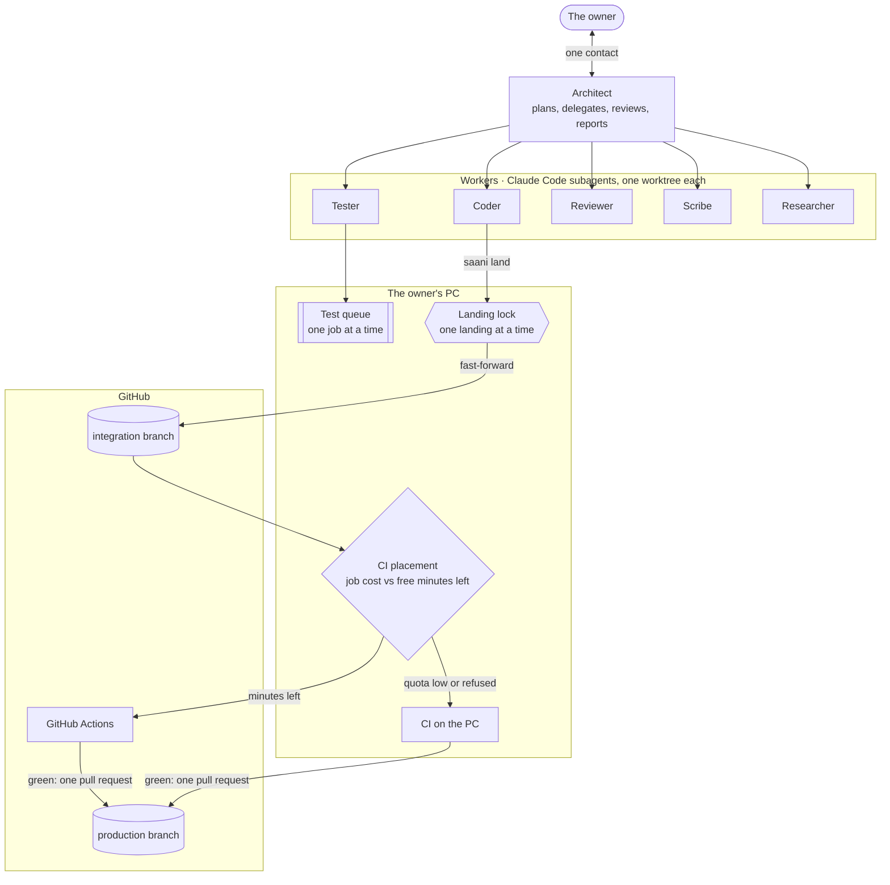

# Saani

Saani is how an AI workshop builds a GitHub project. The owner talks to one contact, **the Architect** (the main Claude Code session), who
plans the work, hands parts of it to **workers** (Claude Code subagents, each with a model that fits its job), checks what they bring back
and reports. Saani is the set of commands, rules and pages that keeps that workshop safe and fast: one worktree per task, landings one at a
time, one test queue for the whole PC, CI within GitHub's free minutes, long unattended runs, and a board that shows every issue on its way.

The status of each feature lives in its GitHub issue (epic: Saani v1), never in this page. The settings of a project live in its
`saani.toml` ([CONFIG.md](CONFIG.md)).

## Principles
- **One contact.** The owner speaks with the Architect. The Architect delegates, follows up, decides what comes back to the owner, and asks
  one question at a time, with a recommendation.
- **The right model for each job, from any provider.** A worker is defined by its role and its contract (a task in; a result and its cost
  out), never by a vendor. Each role gets the cheapest model that meets its quality bar, measured. No model at all where a script does the
  job.
- **GitHub CI within the free minutes, the PC for the rest.** GitHub Actions as much as the free plan allows (2,000 minutes a month for
  private repositories, one pool for the whole account), the PC for the rest, decided job by job (`saani ci`). A pull request does not start
  CI by itself: Saani starts it.
- **One worktree per task.** Each task gets its own folder, `<wt>/<issue>-<slug>`, on a branch `<type>/<issue>-<slug>` made from the
  integration branch. Two workers never share a folder. The type comes from the issue's GitHub Type (`[issues] types`); an issue without a
  Type is refused, and a branch's prefix is never renamed if the Type changes later.
- **Landing one at a time.** A worker that is done takes the landing lock, merges the integration branch, resolves its conflicts, rebuilds
  the generated files, runs its tests again and pushes. Then the next one.
- **One test queue.** The tests are the only heavy load on the PC (the models run remotely). One runner takes test jobs in order and gives
  each the whole machine: landings first, then tier 1, then full runs.
- **The record of a change is its commit message**: `refs #n`, the trailers `Why:` and `Undo:`, then a comment on the issue. A commit on a
  worker's branch or on the integration branch without them is refused (the commit-msg hook, and `land` checks every commit).
- **Narrow keys.** No worker holds a key that can do more than its one job (planned: Sentinel with read-only diagnostics, Deployer with a
  deploy-only key behind the owner's tap). A passphrase is never pasted into a chat.

## At a glance

## Commands
`python -I saani.py <command>`, from inside the project's checkout (README, "Install", for a shorter `saani`).

| Command | What it does |
|---|---|
| `saani new <n>` | Reads issue `n`'s Type (refused without one), makes `<wt>/<n>-<slug>` on `<type>/<n>-<slug>` from `origin/<integration>` (or reuses the issue's existing branch), makes `build/` and copies in the newest timing report, switches on the commit-msg hook for that worktree when the project has `.githooks/`, assigns the issue to the owner. `--slug` names it, `--no-assign` skips the assignment. Warns when the issue has no milestone. |
| `saani new <n> --hotfix` | An urgent fix for production: `<type>/<n>-hotfix-<slug>` from the prod tag (what is live), any Type (none: `[issues] hotfix_default_type`); it lists the production commits that are not live, as a warning. `land` on such a branch never touches the integration branch: tier 1 against production, the branch pushed, the pull request into production opened. |
| `saani land` | From inside the worktree: the checks, the lock, the merge, the generated files rebuilt, tier 1, `git push origin HEAD:<integration>` (never forced), the lock released, the landing recorded, the worktree and its local branch removed, the landing commented on the issue (the `On dev` kind) and the issue labelled `in-dev` (`--no-comment` only prints that step; when `gh` refuses it prints it too). `--keep` leaves them, `--dry-run` only checks, `--worktree <path>` lands that worktree from any folder (a long run cannot change folder). |
| `saani status` | The lock's holder, the worktrees, the conflicts per landing, the merged branches waiting for `prune`, the test queue. |
| `saani longrun [--id ID]` | A throwaway worktree for a long run: folder `longrun-<YYYY-MM-DD_HHMM>` beside the workers' worktrees, branch `longrun/<same id>` from the integration branch (never landed; `saani prune` keeps it). |
| `saani prune [--dry-run] [--local-only]` | Deletes the merged branches: local ones inside production or the integration branch, on GitHub the ones inside production; never those two, a `longrun/*` branch or a branch checked out in a worktree. |
| `saani test [--kind tier1\|land\|full] -- <cmd>` | Runs a test command through the test queue. |
| `saani check-msg <file>` | The commit-msg hook. |
| `saani ci status\|sync\|pr\|merged\|place` | Hybrid CI (below). |
| `saani kpis [--since D] [--until D] [--baseline] [--json]` | The numbers over a window (below). |
| `saani ui [--open] [--json]` | The local status page and the board (below): one board for every project in the list below, the one it starts in included. A second `saani ui` finds the running one and opens it. `saani board` is an alias. |
| `saani projects [list\|add [FOLDER]\|remove OWNER/NAME]` | The projects the board's selector offers, in `~/.saani/projects.toml`. |
| `saani progress run\|show\|watch` | A progress bar with the remaining time for a test run in the background. |

## Landing, in detail
- **Before the lock**, `land` refuses: a branch that is not a worker's, uncommitted changes, a commit without the trailers (merges
  excepted), and a change to a frozen file (`[land] frozen`) once its mark is on the integration branch.
- **The lock** is a file in the repository's shared git folder (`.git/saani-landing.lock`), made atomically, so every worktree sees it. A
  second landing waits (`--wait`, 60 minutes by default); a lock older than `lock_stale_hours` is taken over.
- **Conflicts.** A conflict only in a generated file is solved by the landing (the integration copy, rebuilt next). Any other conflict stops
  the landing and releases the lock: the worker resolves it, commits, and lands again.
- **Generated files** (`[land] generated`, rebuilt by `[land] rebuild`) are rebuilt at landing and committed there, so workers never commit
  them.
- **Tier 1 red, or a push refused** (the integration branch moved): the landing merges again and retries, tier 1 again only when the new
  commits touch the branch's files, at most `push_attempts` times; otherwise it stops and nothing reaches the integration branch.
- **Landing while a pull request is open**: a finished task lands at once. Each landing makes that pull request's CI stale; the CI runs once
  more right before the merge, and that run is the one that counts.
- **The measure**: each landing appends a line to `build/saani-landings.jsonl` of the main checkout; `saani status` sums it, `saani kpis`
  splits it by file and by window.

## The test queue
Two test runs at once slow each other down and break browser tests with timeouts, so every test job waits for its turn and then has the
whole PC.
- **No daemon.** Each call writes a job file in the shared git folder (`.git/saani-tests/`), waits until it is the first waiting job, takes
  the runner lock (a file made atomically), runs, and releases it.
- **Priority:** a landing first (it holds the landing lock), then tier 1, then the full run; same priority by arrival.
- **Dead jobs** (the process is gone) and a runner lock whose holder is gone are dropped by the next caller.
- **Shared tier 1:** a second tier 1 of the same worktree, commit and command, queued while the first runs, takes the first one's result.
- **The measure:** one line per job in `build/saani-tests.jsonl` of the main checkout.

## Test tiers
| Tier | When | What runs | Setting |
|---|---|---|---|
| 0 | while coding an issue | the tests of that issue | the worker's choice |
| 1 | before each landing | the tests a change can affect | `[tests] tier1` |
| 2 | before a release, and the PC's CI | everything | `[tests] full` (after `[tests] check`) |

A project that cannot tell which tests a change affects sets tier 1 to its whole suite; a faster tier 1 is the project's own script.

## CI within the free minutes
`saani ci`. The minutes used this month come from GitHub's billing API (every repository of the account: the free minutes are one pool).
- A **heavy** job (`[ci] jobs`, `heavy = true`: the pull request CI) runs on GitHub only if `reserve_minutes` stay after it and the month is
  not spending faster than it passes (`pace_slack`); otherwise on the PC.
- A **small** job runs on GitHub while any minute is left; `saani ci sync` switches the small automatic workflows (those with a `workflow`)
  on or off.
- A job GitHub **refuses** (no step ran: quota out or billing) falls back to the PC by itself.
- A project whose `[ci] workflow` file is not on GitHub's default branch yet has nothing to run there: `saani ci pr` runs the CI on the PC and says so in the status. `saani ci pr --pc` forces the PC whatever the budget says.
- On the PC, `saani ci pr` tests the pull request's head in a temporary worktree (`[tests] check`, then `[tests] full` through the test
  queue), removed after. Either way the result is the commit status `[ci] status_context` on the pull request's head.
- After a merge into production, `saani ci merged <PR>` checks that the relabel workflow ran, or runs `[ci] relabel` here.
- Every decision goes to `build/saani-ci.json`.

## The status page and the board
`saani ui` (alias `saani board`) serves `http://127.0.0.1:<port>/` on this PC only (any other Host is refused), refreshed every 5 s, read-only.
- **`/kanban`, the kanban page:** one card per issue (Waiting for you, Ready, Building, Testing, Merged, To deploy, Deployed), each with what it
  needs and a "Copy prompt" to paste to the Architect; the open pull request with its CI in three colours; the Claude Code sessions of the
  project and what each works on (folder, branch, issue numbers only, never message text); the subagents (defined, planned, built in); the
  PC's load.
- **`/`, the board (the default page; `/board` still opens it):** the same issues as a desert war-game board seen from above. Each lifecycle step is a zone along a road from START
  (bottom left) to END (top right), with branches (to deploy or to close) and the ways back (tests failed, CI red, needs you, hotfix, not
  planned). Each issue is a block (its colour is its milestone; a ring when it needs the owner; a pennant for whether a long run can take
  it); each worker is a figure. Hover for a summary, click for the full panel (context, acceptance criteria, history, long-run fit, the
  prompt and the folder to paste it in). Pan and zoom with mouse, keyboard and touch.
- Both pages have a top bar with the page switch (Board · Kanban), the project selector (a dot and a count when something waits for the owner in that project; the choice is in the address, `#acme-webshop`, so a bookmark opens it) and a refresh, and read the same `/api/state`.
- The board is one HTML file (`saani/board.html`) that also works as a published artifact: it reads `/api/state`, and falls back to
  `mock-state.json` beside it. Its data: [board-data-contract.md](board-data-contract.md).

## Two modes
| | Present | Away (long run) |
|---|---|---|
| The owner | at the keyboard | asleep or out |
| Questions | allowed, one at a time, with a recommendation | none: a refused call is skipped and noted for the report |
| Tests | tier 0 and tier 1; tier 2 before the pull request | tier 1 per landing, tier 2 at the end |
| Deploy | the owner runs it (planned: the Deployer asks, the owner taps) | only if the owner started the run so |

The long-run checklist is the plugin's skill (`skills/longrun/SKILL.md`).

Issues and comments have one shape. A new issue starts from the template of its Type (`.github/ISSUE_TEMPLATE/`): an **At a glance** table
(Long run, Deploy, Needs the owner, Blocked by, Parent), then Context, Result, Acceptance criteria, Scope, Decisions for the owner and Links.
A comment starts with one of the kinds in `.github/COMMENT_KINDS.md` (`▶ Started`, `⚙ Progress`, `❓ Question`, `⛔ Blocked`, `✅ On dev`,
`🚀 On main`, `✔ Deployed`, `🔗 Linked`). `saani/glance.py` reads the At a glance table (the long-run fit, what is deployed, what the owner is
asked, what blocks the issue); the board and the long run read it through that one parser.

## KPIs
`saani kpis` counts what the repository and the logs know: issues landed per day (from the `refs #n` of the integration branch's commits),
landings and conflicts by file, test jobs per kind (median wait and run, failures). The owner's waiting time and interventions and the tokens
per issue have no machine record: it says "not measured". `--baseline` adds the window of the same length just before (git history only).

## Models and cost
1. **No model where a script will do.** Running tests, landing, relabelling and the gate are scripts. A model only reads a failure and says
   what it means.
2. **Judgement stays on the strongest model.** The Architect and the Reviewer keep a top model; a weak review lets bugs through.
3. **Routine roles go to the cheapest model that passes.** The Scribe, the Researcher's first pass, the Tester's summary and simple coding
   tasks are candidates for cheaper models, from any provider. Chosen by a trial, never by a price list alone.
4. **Through a harness that keeps the rules.** Whatever the tool, a worker gets the same limits: its own worktree, no push except through the
   landing, no keys. A tool that cannot enforce that runs read-only.
5. **Data.** The code and the prompts go to the provider of each model; a provider that trains on inputs is not used.
6. **Measured.** Each run logs its model and cost; a role moves to a cheaper model only after a trial on real issues shows the same quality.

## Choices, and why
- **Claude Code subagents.** A coding tool with editing, git, tests, review, hooks and permissions per worker.
- **No cockpit app.** Multi-agent cockpits show many agents to a human who dispatches them; here the Architect dispatches and the owner keeps
  one conversation. The board is enough for a glance.
- **Agent teams later.** Claude Code's agent teams are experimental and document no worktree per teammate; they are to be tried on research
  and review only.

Sources: [Claude Code subagents](https://code.claude.com/docs/en/sub-agents), [Claude Code agent teams](https://code.claude.com/docs/en/agent-teams).
